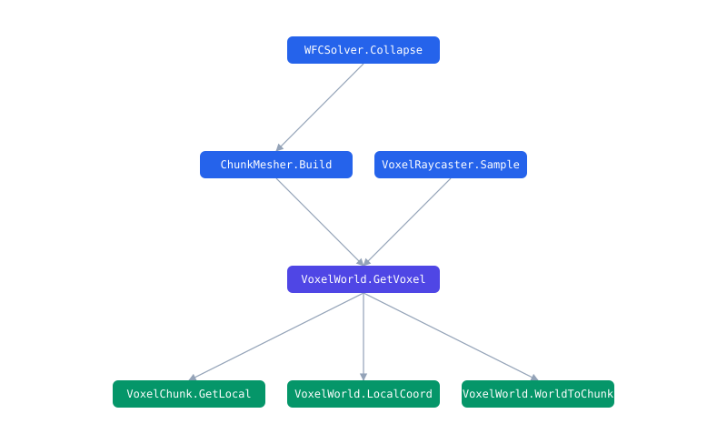

# LynxMCP

**A local code index and call graph for Claude Code, Cursor, Windsurf, Antigravity and VS Code.**
Search by meaning and by name, trace who calls or implements what, and index library docs or PDFs alongside your code. Everything runs on your machine.

[](https://github.com/lorenzo-cambiaghi/LynxMCP/actions/workflows/test.yml)
[](LICENSE)

[](https://glama.ai/mcp/servers/lorenzo-cambiaghi/LynxMCP)

[](https://glama.ai/mcp/servers/lorenzo-cambiaghi/LynxMCP)

---

## Quickstart

No config file, no Docker, no API key, no PyTorch. Embeddings run locally on ONNX Runtime (~460 MB on disk), the index lives in your user cache so `git status` stays clean, and the code graph is on by default.

### Claude Code

```bash
uv tool install lynx-mcp       # or: pipx install lynx-mcp
lynx connect claude
```

Every project you open in Claude Code gets its own index, built in the background the first time. `lynx connect claude` also wires a prompt hook into `~/.claude/settings.json` so each request arrives with a compact map of relevant code (up to 12 locations with file, line range and signature) before the first turn. Pass `--no-hook` to skip it. Restart Claude Code (or run `/mcp`) and start asking questions.

Prefer to test it in a single project first?

```bash
claude mcp add lynx -- uvx --from lynx-mcp lynx serve .
```

<details>
<summary>Optional: add the prompt hook to just that project (<code>.claude/settings.json</code>)</summary>

```json
{"hooks": {"UserPromptSubmit": [{"hooks": [{"type": "mcp_tool", "server": "lynx",
  "tool": "prompt_hook", "input": {"prompt": "${prompt}"}}]}]}}
```

</details>

### Cursor, Claude Desktop, Windsurf, Antigravity, VS Code

```bash
uv tool install lynx-mcp
cd /path/to/your/project
lynx connect cursor            # or: claude-desktop | windsurf | antigravity | vscode
```

`lynx connect` writes only the `lynx` entry into your editor's MCP config, keeps a timestamped backup, and leaves every other server untouched. Restart your editor to pick it up.

### Prefer a desktop installer?

Download the [macOS or Windows installer](https://github.com/lorenzo-cambiaghi/LynxMCP/releases) to open **LynxManager** in your browser (`lynx manager ui` opens the same UI from the CLI). **Simple mode** guides you through three steps: pick a folder, connect your editor in one click, and run a search. **Expert mode** unlocks the JSON config editor, Doctor diagnostics, the graph/diff playground and the OpenAPI endpoints.

### Updating

```bash
lynx update
```

Detects `uv`, `pipx`, `pip` and `uvx` installs and upgrades in place without touching your config or indexes. On Windows, close your AI editors first so no running Lynx process holds index files open (the update button in LynxManager closes itself, updates in a separate window, and reopens automatically).

---

## Why Lynx alongside grep

`grep` is fast and right whenever you already know the exact identifier. Lynx handles the rest: finding code by what it *does*, navigating call and inheritance graphs before you edit, checking for duplicate implementations, and searching docs or other repositories that aren't even in your current workspace.

| | Keyword `grep` | Lynx |
|---|---|---|
| **Matches** | Exact strings or regexes | Meaning (ONNX embeddings) + code-aware BM25, fused |
| **Different wording** | Returns nothing | Matches by concept even when names differ |
| **Output** | Individual lines; you still open the file | Whole AST chunks (function or class) with symbol name and line range |
| **Ranking** | File order on disk | Ranked by relevance; tests, data and docs ranked below production code |
| **Structure & impact** | None: a name match doesn't show callers or subtypes | Code graph resolved from imports and declarations: callers, callees, subclasses, blast radius and tests |
| **Across sessions** | Starts from zero every time | Persistent local index; re-indexes saved files in ~2s |
| **Beyond the current repo** | Only files in the open folder | Multiple local repos, version-pinned web docs and PDFs in one server |
| **Trade-off** | Zero setup | One-time index build |

### Questions grep can't answer directly

| Question | With `grep` | With Lynx |
|---|---|---|
| *"What breaks if I change `ApplyDamage`?"* | Textual mentions of the string | **`impact`**: transitive callers with hop distance + affected tests |
| *"Who implements `IWeapon` or inherits from `Field`?"* | Regex guesses + manual file reads to filter comments | **`graph_query`**: resolved inheritance and call edges with `file:line` |
| *"Do we already have a helper like this?"* | Guess possible function names | **`find_similar`**: ranks existing implementations by semantic similarity |
| *"How does this API work in the library version we ship?"* | Model memory (often outdated) | **Indexed web docs & PDFs**, cited with exact URL or page number |

Built-in `grep` is still the right choice on small repos or when you already know the exact symbol name. Lynx shines on larger codebases, unfamiliar architectures, multi-repo workspaces, and library docs or PDFs the model hasn't seen.

---

## Multiple repos, library docs & PDFs in one server

Index your main project alongside a shared internal library, framework documentation, or a folder of PDF specs, all searchable from the same editor session:

```bash
lynx manager init
lynx source add myproject --type codebase --path /path/to/your/repo
lynx source add mylib     --type codebase --path /path/to/shared/lib
lynx source add reactdocs --type webdoc   --url  https://react.dev/reference/
lynx source add manuals   --type pdf      --path /path/to/pdfs
lynx build
lynx connect cursor --config ./config.json
```

One `config.json` holds all sources. You can scope any editor window to a subset with `--source myproject --source reactdocs`, and multiple editor windows share the same index safely.

---

## Visual tour

<p align="center">
  
  <br>
  <sub><code>lynx graph export --symbol GetVoxel</code> writes a single self-contained HTML file with callers above and callees below, handy for PR reviews or architecture audits.</sub>
</p>

<p align="center">
  <a href="docs/GUIDE.md#lynxmanager-guided-setup-web-ui-diagnostics-new-in-v09">
    
  </a>
  <br>
  <sub>LynxManager: guided setup and one-click editor connection in Simple mode; full config editor, playground and diagnostics in Expert mode.</sub>
</p>

---

## Benchmarks (reproducible)

Single-shot retrieval quality on three public codebases in three languages, using behavioural questions with known ground-truth files, compared against an IDF-weighted multi-keyword grep baseline. Per-task tables: [Django](benchmarks/RESULTS.md) · [Json.NET](benchmarks/RESULTS_csharp.md) · [Guava](benchmarks/RESULTS_java.md).

| grep / Lynx (v1.12.0) | Django 5.2 (Python) | Json.NET (C#) | Guava (Java) |
|---|---|---|---|
| **Corpus** | 883 files, 158k lines, 20 questions | 240 files, 69k lines, 15 questions | 606 files, 181k lines, 15 questions |
| **hit@1** (top result right) | 45% / **70%** | 33% / **67%** | **73%** / 67% |
| **hit@5** (in top 5) | **95%** / 90% | 67% / **73%** | **93%** / 87% |
| **MRR** | 0.64 / **0.79** | 0.47 / **0.70** | **0.81** / 0.76 |

**Key takeaways:**
- **Behavioural queries (Django, Json.NET):** Lynx puts the right file first far more often (**70% vs 45%** on Django, **67% vs 33%** on Json.NET) because it matches intent, not just literal tokens.
- **Exact-name queries (Guava):** when class names like `BloomFilter` or `RateLimiter` already match the question's wording, keyword grep edges ahead, and the two work best side by side.
- **Compact context:** `search(outline=true)` returns signatures and first doc lines instead of full bodies (**2.4× smaller**, [measured](docs/OUTLINE.md)), and three tool profiles keep schema overhead bounded (`core`: 6.0k chars, `standard`: 10.6k, `full`: 16.2k).

<details>
<summary><b>Commands to reproduce all three benchmarks</b></summary>

```bash
# Python (Django 5.2)
git clone --depth 1 --branch 5.2 https://github.com/django/django.git benchmarks/_target/django
python benchmarks/run_benchmark.py && python benchmarks/structural_demo.py

# C# (Json.NET)
git clone --depth 1 https://github.com/JamesNK/Newtonsoft.Json.git benchmarks/_target/jsonnet
python benchmarks/run_benchmark.py --tasks benchmarks/tasks_jsonnet.json \
  --target-dir benchmarks/_target/jsonnet --storage-dir benchmarks/_storage_csharp \
  --results-json benchmarks/results_csharp.json --results-md benchmarks/RESULTS_csharp.md

# Java (Guava)
git clone --depth 1 https://github.com/google/guava.git benchmarks/_target/guava
python benchmarks/run_benchmark.py --tasks benchmarks/tasks_guava.json \
  --target-dir benchmarks/_target/guava --storage-dir benchmarks/_storage_java \
  --results-json benchmarks/results_java.json --results-md benchmarks/RESULTS_java.md
```

</details>

---

## How it works


- **AST chunking (20 languages):** Tree-sitter splits code along function and class boundaries, never arbitrary character windows. Supported grammars include Python, TypeScript/TSX, JavaScript, C#, C, C++, Rust, Go, Java, GDScript, Kotlin, Swift, Ruby, PHP, Lua, Scala, SQL, Bash and Objective-C.
- **Hybrid retrieval:** Every search fuses dense ONNX embeddings (`BAAI/bge-small-en-v1.5`) with a code-tokenized BM25 index (covering bodies, symbol names and file paths) via reciprocal rank fusion, ranking production code above tests, data and docs. An optional local cross-encoder reranker is built in.
- **Code graph:** Built from imports, declarations and call sites across files. It powers `impact`, `describe_symbol`, `find_usages`, `graph_query` and `export_graph`.
- **100% local & offline:** The embedding model downloads once (with a GitHub Release fallback for firewalled or air-gapped networks). No cloud index, no telemetry, no code leaves your machine.
- **Fast startup:** The MCP handshake completes in 1 to 2 seconds while indexes open in the background; a file watcher re-indexes saved files in ~2 seconds.

---

## The tools your AI gets

The tool surface is fixed regardless of how many sources you configure, split into three profiles:

| Profile | Tools | Schema size |
|---|---|---|
| `core` (7) | `search`, `describe_symbol`, `module_summary`, `find_usages`, `impact`, plus the two hook tools (`prompt_hook`, `read_guard`) | ~1,500 tokens |
| `standard` (12, default) | `core` + `find_definition`, `find_similar`, `graph_query`, `repo_overview`, `search_diff` | ~2,650 tokens |
| `full` (19) | `standard` + `deep_search`, `find_tests_for`, `export_graph`, `feedback`, `list_sources`, `get_rag_status`, `update_source_index` | ~4,050 tokens |

Select a profile with `--profile core|standard|full`, `LYNX_TOOL_PROFILE`, or `tools.profile` / `tools.include` in `config.json`. Every tool is also a CLI subcommand (`lynx search ...`, `lynx find-definition ApplyDamage`, `lynx impact ApplyDamage`, `lynx graph query --op callers --symbol ApplyDamage`) with `--json` for scripts.

<details>
<summary><b>All 19 tools and what each answers</b></summary>

| Tool | Profile | What it answers |
|---|---|---|
| `search(query, identifiers?, source?, outline?)` | core | Hybrid search across one or all sources. Pass known symbol names in `identifiers`, or `outline=true` for signatures only (2.4× smaller). |
| `describe_symbol(symbol, file?)` | core | Definition, callers, callees and tests in one call; for a class, also bases, subtypes and member signatures. Optional `file` disambiguates same-name definitions. |
| `module_summary(file)` | core | Every symbol in a file with its signature and doc line, plus its imports and dependents. |
| `find_usages(symbol)` | core | Callers from the graph, subtypes and textual references with line numbers. |
| `impact(symbol)` | core | Transitive blast radius through the call graph with hop distance, plus tests to re-run. |
| `prompt_hook(prompt)` | core | Called by Claude Code's `UserPromptSubmit` hook (not the model) to prepend a compact map of relevant code. |
| `read_guard(file_path?, offset?, limit?, command?)` | core | Optional `PreToolUse` hook on `Read` / `Bash` (not for the model): refuses a read of more than 200 lines of an indexed file once, with the file's outline; the same read asked again goes through. |
| `find_definition(symbol)` | standard | Where a symbol is defined: full body for the top match, signatures for the rest. |
| `find_similar(snippet)` | standard | Checks whether a draft duplicates existing code and ranks similar implementations. |
| `graph_query(operation, symbol?)` | standard | `callers`, `callees`, `subclasses`, `superclasses`, `imports`, `neighbors`, `shortest_path`, `overview`, `surprising_connections`, `status`. |
| `repo_overview()` | standard | Languages, frameworks, entry points and build/test/run commands. |
| `search_diff(query, base?)` | standard | Search scoped to files changed against a base branch, useful for code review. |
| `deep_search(queries, source?)` | full | Tries multiple query phrasings in sequence when a single `search` is weak. |
| `find_tests_for(symbol)` | full | Tests covering a symbol directly or through the call graph. |
| `export_graph(target, mode?)` | full | Exports a self-contained offline HTML view of a symbol's blast radius or a file hub. |
| `feedback(trying_to_do, tried, stuck)` | full | Logs local notes when an agent couldn't find something, to help tune sources. |
| `list_sources` / `get_rag_status` / `update_source_index` | full | Inspect configured sources and trigger a manual refresh. |

Retrieval tools advertise the MCP `readOnlyHint` annotation so clients can auto-approve them. `search` sets `anthropic/alwaysLoad` so Claude Code keeps it immediately available while loading the remaining tools on demand.

</details>

---

## Integrations

Search and the code graph are also exposed over a local HTTP API (`/api/v1`) with OpenAPI 3.1 metadata and NDJSON streaming, bound to `127.0.0.1`:

- **[Coral 1.x](docs/CORAL.md):** point it at `/api/v1/openapi.json` to add Lynx as a typed provider next to GitHub or Sentry (Coral 0.x SQL tables continue to work).
- **[DuckDB](docs/DUCKDB.md):** query Lynx directly via `read_ndjson_auto('http://127.0.0.1:8765/api/v1/search?...')` to join code relevance with git churn, logs or tickets.
- **[Steampipe](integrations/steampipe/steampipe-plugin-lynx/):** `lynx_source`, `lynx_search` and `lynx_graph` SQL tables ([prebuilt binaries](https://github.com/lorenzo-cambiaghi/LynxMCP/releases?q=steampipe)).
- **[GitHub Action](integrations/github-action/):** posts downstream callers and related code on pull requests.
- **[Agent rules](integrations/agent-rules/lynx-rules.md) & [MCP recipes](docs/MCP_RECIPES.md):** drop-in `CLAUDE.md` / `AGENTS.md` pointer and workflows combining Lynx with GitHub, Sentry and Jira.

<p align="center">
  
  <br>
  <sub>Point Coral at <code>/api/v1/openapi.json</code> and it exposes four typed tools automatically.</sub>
</p>

---

## Documentation

| | |
|---|---|
| [Full guide](docs/GUIDE.md) | Configuration, codebase / webdoc / PDF sources, retrieval internals, tool profiles, hooks, air-gapped setup |
| [Outline mode](docs/OUTLINE.md) | Signatures instead of bodies: 2.4× smaller output, measured data & chart |
| [Coral](docs/CORAL.md) | Code search and code graph as typed tools in Coral 1.x |
| [DuckDB](docs/DUCKDB.md) / [Steampipe](integrations/steampipe/steampipe-plugin-lynx/) | Code search and code graph as SQL tables |
| [Agent rules snippet](integrations/agent-rules/lynx-rules.md) | Short pointer for `AGENTS.md` / `CLAUDE.md` |
| [MCP recipes](docs/MCP_RECIPES.md) | Combining Lynx with GitHub, Sentry and Jira MCP servers |
| [GitHub Action](integrations/github-action/) | Automated PR impact analysis on every pull request |
| [config.example.json](config.example.json) | Annotated v2 configuration reference |

## Status & License

Developed independently; issues and PRs are welcome (see [ROADMAP.md](ROADMAP.md)). Licensed under [Apache 2.0](LICENSE).

---

<!-- MCP Registry ownership marker. It must stay in the README published on
     PyPI so registry.modelcontextprotocol.io can verify the package.
mcp-name: io.github.lorenzo-cambiaghi/lynx
-->
