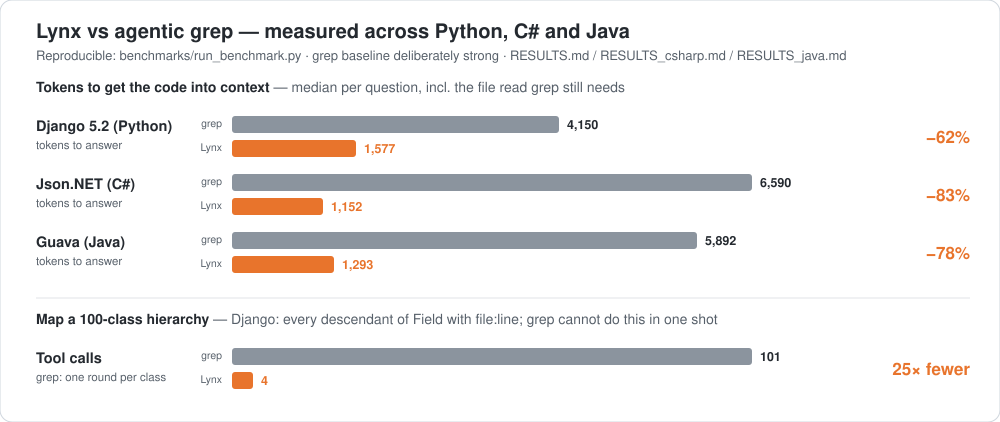
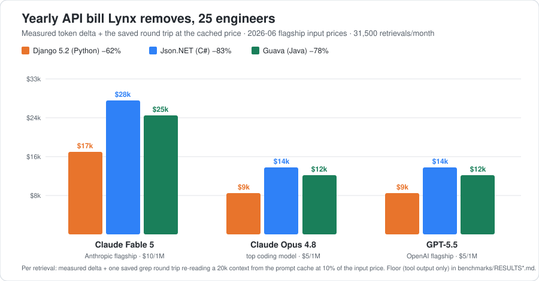
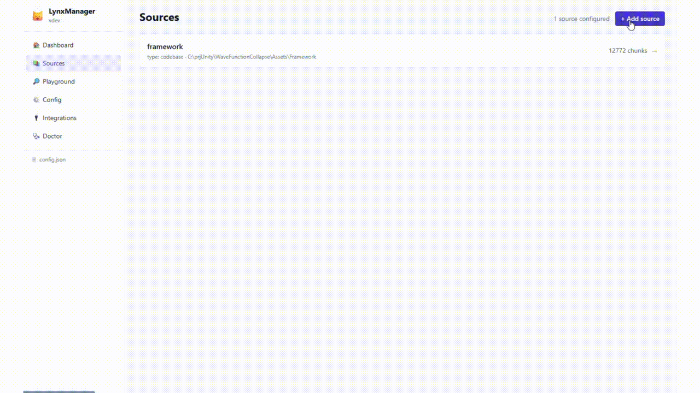
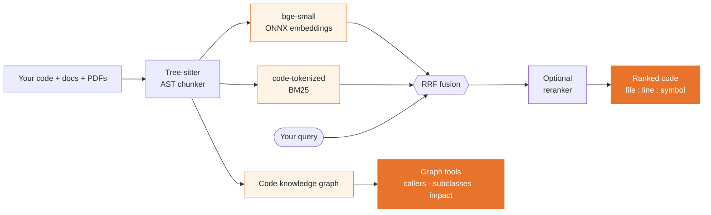
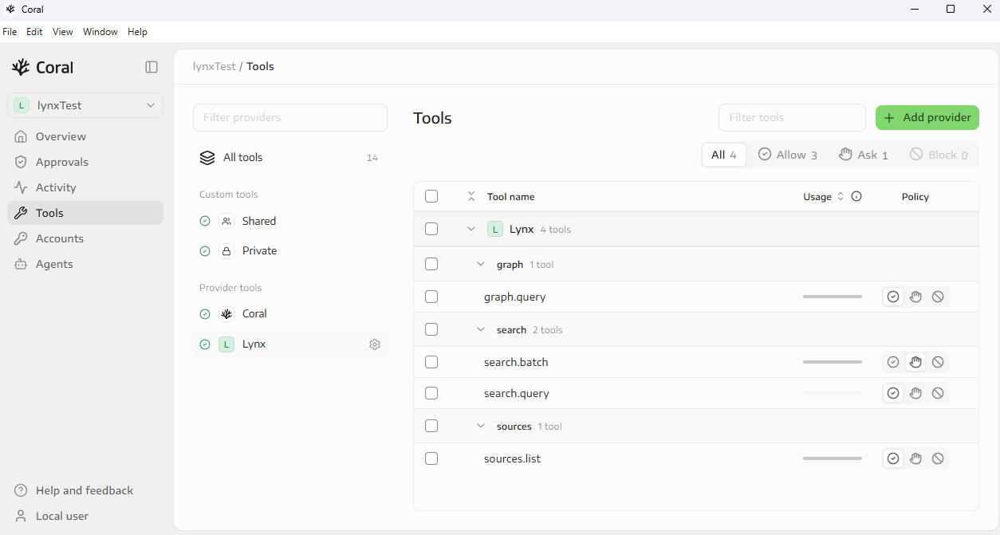

# LynxMCP

**A local code graph and semantic search for Claude Code, Cursor, Windsurf and Antigravity. 62% to 83% fewer tokens per retrieval, and your code never leaves the machine.**

[](https://github.com/lorenzo-cambiaghi/LynxMCP/actions/workflows/test.yml)
[](LICENSE)

[](https://glama.ai/mcp/servers/lorenzo-cambiaghi/LynxMCP)

[](https://glama.ai/mcp/servers/lorenzo-cambiaghi/LynxMCP)

---

## Quickstart

No config file, no Docker, no API key, no PyTorch. The embeddings run on ONNX Runtime (about 460 MB on disk), the index lives in your user cache folder so `git status` stays clean, and the code graph is on from the start.

### Claude Code

```bash
uv tool install lynx-mcp       # or: pipx install lynx-mcp
lynx connect claude
```

Every project you open in Claude Code now gets its own index, built in the background the first time. `lynx connect claude` also adds a prompt hook to `~/.claude/settings.json`: each request reaches Claude with a short map of the code it is about (up to 12 places, file, lines and signature, about 1,300 characters), so the first turn already knows where to look instead of grepping for it. `--no-hook` leaves it out. Restart Claude Code (or run `/mcp`) and ask about your code.

Just want to try it in one project first?

```bash
claude mcp add lynx -- uvx --from lynx-mcp lynx serve .
```

uvx keeps the version it downloaded the first time. `lynx update` tells you how to refresh it. For the prompt hook in that project, add this to its `.claude/settings.json`:

```json
{"hooks": {"UserPromptSubmit": [{"hooks": [{"type": "mcp_tool", "server": "lynx",
  "tool": "prompt_hook", "input": {"prompt": "${prompt}"}}]}]}}
```

### Cursor, Claude Desktop, Windsurf, Antigravity, VS Code

```bash
uv tool install lynx-mcp
cd /path/to/your/project
lynx connect cursor            # or: claude-desktop | windsurf | antigravity | vscode
```

`lynx connect` adds one entry to the editor's MCP config and leaves every other server alone. It keeps a timestamped backup of the file, and if Lynx is already registered under another name it updates that entry instead of adding a second one. Restart the editor afterwards.

### Without a terminal

The [macOS and Windows installers](https://github.com/lorenzo-cambiaghi/LynxMCP/releases) open **LynxManager** in your browser (`lynx manager ui` does the same). Simple mode walks you through three steps: pick the project folder, connect your editor with one click, try a search. Expert mode shows the full JSON config, the Doctor diagnostics, the graph and diff playground and the OpenAPI endpoints.

### Updating

```bash
lynx update
```

It recognises uv, pipx, pip and uvx installs and upgrades them in place; your config and indexes stay as they are. The desktop installer gets a link to the new download. On Windows, close your editors and LynxManager first: Windows will not replace files a running Lynx holds open, so `lynx update` lists those processes and stops before touching anything. The update button in LynxManager closes the manager, updates in its own window and reopens it.

<details>
<summary><b>Several repositories, library docs and PDFs in one server</b></summary>

```bash
lynx manager init
lynx source add myproject --type codebase --path /path/to/your/repo
lynx source add reactdocs --type webdoc --url https://react.dev/reference/
lynx source add manuals   --type pdf --path /path/to/pdfs
lynx build
lynx connect cursor --config ./config.json
```

One `config.json` holds all your repositories, web docs and PDFs. Each project's MCP entry can ask for a subset with `--source game --source docs`, and several editor windows share one index.

</details>

---

## What grep can't answer

Grep is the right tool when you already know the exact identifier. Lynx is for the other questions: how something behaves, who calls or inherits from what, what breaks if you change it, and what a library does in a version newer than the model's training data. All of it runs locally.

| Question | Agentic grep | Lynx |
|---|---|---|
| *"What inherits from `Field`?"* (Django, 100 classes over 4 levels) | 101 grep rounds, one per discovered class | **4 `graph_query` calls**, `file:line` on every edge |
| *"What breaks if I change `ApplyDamage`?"* | Textual mentions of the name | **`impact`**: every transitive caller with hop distance + tests to re-run |
| *"Where do we validate session tokens?"* on C# (Json.NET) | hit@1 33% | **hit@1 67%** |
| *"How does this API behave in the version we ship?"* | The model's stale memory | **Your indexed docs & PDFs**, cited with exact URL / page number |

Grep still wins in places. On Guava, where class names like `BloomFilter` and `RateLimiter` describe themselves, it ranks slightly higher (hit@1 73% against 67%). On a small repo that fits in context the built-in tools are enough. Lynx pays off on real codebases, on framework docs the model has never seen, and across sessions that would otherwise explore the same code from scratch.

---

## Benchmarks (reproducible)



Three public codebases in three languages, behavioural questions with known ground-truth files, measured against a strong IDF-weighted multi-keyword grep baseline. Per-task results: [Django](benchmarks/RESULTS.md) · [Json.NET](benchmarks/RESULTS_csharp.md) · [Guava](benchmarks/RESULTS_java.md).

| grep / Lynx | Django 5.2 (Python) | Json.NET (C#) | Guava (Java) |
|---|---|---|---|
| corpus | 883 files, 158k lines, 20 questions | 240 files, 69k lines, 15 questions | 606 files, 181k lines, 15 questions |
| hit@5 | 95% / **100%** | 67% / **73%** | **93%** / 87% |
| hit@1 | 45% / **60%** | 33% / **67%** | **73%** / 67% |
| MRR | 0.64 / **0.77** | 0.47 / **0.70** | **0.81** / 0.74 |
| median tokens to answer | 4,150 / **1,577** (-62%) | 6,590 / **1,152** (-83%) | 5,892 / **1,293** (-78%) |
| tool round-trips before code is in context | 2+ / **1** | 2+ / **1** | 2+ / **1** |

<details>
<summary><b>Commands to reproduce all 3 benchmarks yourself</b></summary>

```bash
# Python (Django)
git clone --depth 1 --branch 5.2 https://github.com/django/django.git benchmarks/_target/django
python benchmarks/run_benchmark.py && python benchmarks/structural_demo.py

# C# (Json.NET)
git clone --depth 1 https://github.com/JamesNK/Newtonsoft.Json.git benchmarks/_target/jsonnet
python benchmarks/run_benchmark.py --tasks benchmarks/tasks_jsonnet.json \
  --target-dir benchmarks/_target/jsonnet --storage-dir benchmarks/_storage_csharp \
  --results-json benchmarks/results_csharp.json --results-md benchmarks/RESULTS_csharp.md

# Java (Guava)
git clone --depth 1 https://github.com/google/guava.git benchmarks/_target/guava
python benchmarks/run_benchmark.py --tasks benchmarks/tasks_guava.json \
  --target-dir benchmarks/_target/guava --storage-dir benchmarks/_storage_java \
  --results-json benchmarks/results_java.json --results-md benchmarks/RESULTS_java.md
```

</details>

### Token & API cost impact

Each retrieval keeps **2,600 to 5,400 tokens** out of the context window. With `outline=true`, a broad search returns signatures only and gets another **2.4×** smaller ([measured](docs/OUTLINE.md)). The tool definitions come in three sizes so a session pays only for what it loads: `core` has 6 tools, `standard` (the default) 11, `full` all 18. Whatever the size, the session pays for that schema on every turn after the first retrieval.

For a 25-engineer team (60 retrievals per developer per day), the measured yearly API savings across the three benchmarked codebases:

| Flagship model (input $/1M) | Measured floor | With the saved round trip |
|---|---:|---:|
| Claude Fable 5 ($10) | $9,700 to $20,600 | $17,300 to $28,100 |
| GPT-5.5, Claude Opus 4.8 ($5) | $4,900 to $10,300 | $8,600 to $14,100 |

Plug in your own team size and prices with `python benchmarks/savings_calculator.py --devs N` or the interactive [savings calculator](benchmarks/savings_calculator.html).



---

## Visual tour

<p align="center">
  
  <br>
  <sub><code>lynx graph export --symbol GetVoxel</code> writes one self-contained file with the callers above and the callees below. Attach it to a PR or keep it for an audit.</sub>
</p>

<p align="center">
  <a href="docs/GUIDE.md#lynxmanager-guided-setup-web-ui-diagnostics-new-in-v09">
    
  </a>
  <br>
  <sub>LynxManager: guided setup and one-click editor connection in Simple mode, the full config, the graph playground and the diagnostics in Expert mode.</sub>
</p>

---

## How it works



Code is split along the syntax tree into whole functions and classes, never arbitrary text windows. Twenty languages have a Tree-sitter grammar: Python, TypeScript/TSX, JavaScript, C#, C, C++, Rust, Go, Java, GDScript, Kotlin, Swift, Ruby, PHP, Lua, Scala, SQL, Bash and Objective-C among them.

A query runs against two indexes at once. Dense embeddings (`bge-small-en-v1.5` on ONNX) catch meaning, a code-aware BM25 catches identifiers, and reciprocal rank fusion merges the two lists. A cross-encoder reranker is optional.

The code graph holds calls, inheritance, imports and detected communities. It is what answers `impact`, `describe_symbol`, `find_usages` and `graph_query`.

Sources can be local codebases, documentation sites (with an optional headless Chromium for single-page apps) and PDFs, side by side. A file watcher re-indexes a saved file in about 2 seconds.

Everything is local. The model downloads once, with a GitHub Release fallback for firewalled and air-gapped machines, and from then on Lynx works offline: no telemetry, no cloud index, no upload.

The MCP handshake answers in about a second and the indexes open in the background, so the editor never waits on them. Several editor windows can share one index.

---

## The tools your AI gets

The tool set is fixed. It does not grow with the number of sources, and it comes in three profiles:

| Profile | Tools |
|---|---|
| `core` (6) | `search`, `describe_symbol`, `module_summary`, `find_usages`, `impact`, and `prompt_hook` for the prompt hook |
| `standard` (11, default) | `core` plus `find_definition`, `find_similar`, `graph_query`, `repo_overview`, `search_diff` |
| `full` (18) | adds `deep_search`, `find_tests_for`, `export_graph`, `feedback`, `list_sources`, `get_rag_status`, `update_source_index` |

Pick one with `--profile core|standard|full`, `LYNX_TOOL_PROFILE`, or `tools.profile` / `tools.include` in `config.json`. Every MCP tool is also a CLI subcommand (`lynx find-definition ApplyDamage`, `lynx impact ApplyDamage`, `lynx graph query --op callers --symbol ApplyDamage`); add `--json` for scripts.

<details>
<summary><b>All 18 tools and what each answers</b></summary>

| Tool | Profile | What it answers |
|---|---|---|
| `search(query, source?, outline?)` | core | Hybrid search across one or all sources. `outline=true` returns signatures only, 2.4× smaller, for a first pass. |
| `describe_symbol(symbol)` | core | Code, callers, callees and tests in one call; for a class also its bases, subtypes and member signatures. |
| `module_summary(file)` | core | A file as a unit: every symbol with signature and doc line, its imports and the files that depend on it. |
| `find_usages(symbol)` | core | Every use of X: graph calls, subtypes and textual references with line numbers. |
| `impact(symbol)` | core | The transitive blast radius through the call graph, with hop distance, plus the tests to re-run. |
| `prompt_hook(prompt)` | core | Not for the model. Claude Code's prompt hook calls it with each request and gets back the map of the code that request is about. |
| `find_definition(symbol)` | standard | Where X is defined. The first match with its body, the others with their signature. |
| `find_similar(snippet)` | standard | Whether a draft duplicates existing code, with the parallel implementations ranked. |
| `graph_query(operation, symbol?)` | standard | `callers`, `callees`, `subclasses`, `superclasses`, `imports`, `neighbors`, `shortest_path`, `overview`, `surprising_connections`, `status`. |
| `repo_overview()` | standard | Languages, frameworks, entry points and the build, test and run commands. |
| `search_diff(query, base?)` | standard | Search limited to the files changed against a base branch, for code review. |
| `deep_search(queries, source?)` | full | Several phrasings tried in turn when `search` comes back weak. |
| `find_tests_for(symbol)` | full | Tests that cover X directly or through the call graph. |
| `export_graph(target, mode?)` | full | A self-contained offline graph view of a blast radius or a file hub. |
| `feedback(trying_to_do, tried, stuck)` | full | A local report of what the agent could not find, for tuning sources. |
| `list_sources` / `get_rag_status` / `update_source_index` | full | Introspection and manual index refresh. |

Retrieval tools carry the MCP `readOnlyHint` annotation, so clients can approve them automatically. `search` advertises `anthropic/alwaysLoad`, which keeps Claude Code from hiding it behind deferred tool search; the instructions name the other tools, which Claude Code loads when it needs them.

</details>

---

## Integrations

Search and the code graph are also served over a local HTTP API (`/api/v1`) with OpenAPI 3.1 metadata and NDJSON streaming, bound to `127.0.0.1`.

- [Coral 1.x](docs/CORAL.md) adds Lynx as a typed provider next to GitHub or Sentry once you give it `/api/v1/openapi.json`. Coral 0.x SQL tables still work.
- [DuckDB](docs/DUCKDB.md) reads the API as a table with `read_ndjson_auto('http://127.0.0.1:8765/api/v1/search?...')`, so code relevance joins with git churn, logs or ticket exports without a plugin.
- [Steampipe](integrations/steampipe/steampipe-plugin-lynx/) gets `lynx_source`, `lynx_search` and `lynx_graph` tables ([prebuilt binaries](https://github.com/lorenzo-cambiaghi/LynxMCP/releases?q=steampipe)).
- The [GitHub Action](integrations/github-action/) comments on each pull request with the downstream callers and related code, indexed on the runner.
- The [agent rules](integrations/agent-rules/lynx-rules.md) snippet goes into `CLAUDE.md` or `AGENTS.md`; the [MCP recipes](docs/MCP_RECIPES.md) combine Lynx with the GitHub, Sentry and Jira servers.

<p align="center">
  
  <br>
  <sub>Give Coral the URL of <code>/api/v1/openapi.json</code> and it lists four typed tools.</sub>
</p>

---

## Documentation

| | |
|---|---|
| [Full guide](docs/GUIDE.md) | Configuration, codebase / webdoc / PDF sources, retrieval internals, tool profiles, air-gapped setup |
| [Outline mode](docs/OUTLINE.md) | Signatures instead of bodies: 2.4× token reduction, measured data & chart |
| [Coral](docs/CORAL.md) | Code search and code graph as typed tools in Coral 1.x |
| [DuckDB](docs/DUCKDB.md) / [Steampipe](integrations/steampipe/steampipe-plugin-lynx/) | Code search and code graph as SQL tables |
| [Agent rules snippet](integrations/agent-rules/lynx-rules.md) | Paste into `AGENTS.md` / `CLAUDE.md` so agents find code through Lynx before grepping |
| [MCP recipes](docs/MCP_RECIPES.md) | Combining Lynx with GitHub, Sentry, and Jira MCP servers |
| [GitHub Action](integrations/github-action/) | Automated PR impact analysis on every pull request |
| [config.example.json](config.example.json) | Annotated v2 configuration reference |

## Status & License

Developed independently; issues and PRs are welcome (see [ROADMAP.md](ROADMAP.md)). Licensed under [Apache 2.0](LICENSE).

---

<!-- MCP Registry ownership marker. It must stay in the README published on
     PyPI so registry.modelcontextprotocol.io can verify the package.
mcp-name: io.github.lorenzo-cambiaghi/lynx
-->
