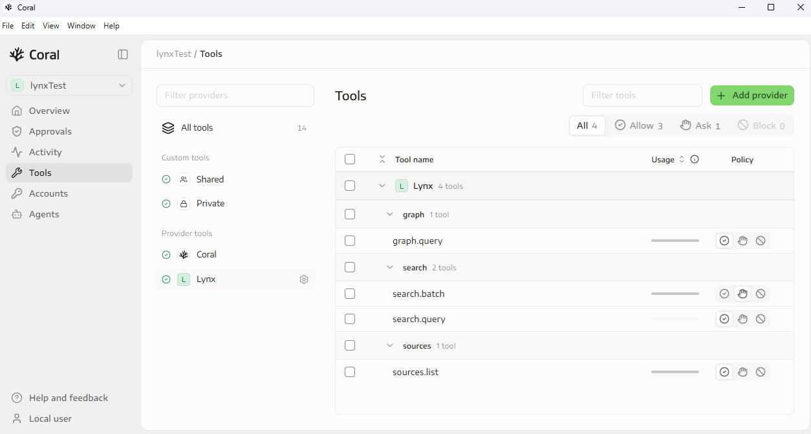

# Using Lynx from Coral

[Coral](https://github.com/withcoral/coral) lets an agent work with the
services you connect to it (GitHub, Linear, Sentry, ...). Lynx brings the part
those services don't have: search and a code graph over your own code, your
library docs and your PDFs, all on your machine. Together they let you
correlate code search with the tools your team already uses:

- Find logic by behavior, not keywords: ranked code locations for a
  plain-language question.
- Locate the code behind a feature and line it up against the repo's open
  PRs before you refactor.
- Take the behavior from a Sentry alert and get the ranked code that
  implements it.
- Map open tickets to their likely code area.
- Pivot from a code hit to its structural blast radius (who calls it,
  what it depends on, what breaks if it changes) and line that up with the
  owners, PRs and tickets in your other services.

Coral changed model at 1.0. Coral 1.x builds a provider from an OpenAPI
document, and Lynx serves one. Coral 0.x read a SQL source manifest instead;
that setup is [further down](#coral-0x-sql-sources).

## Coral 1.x: Lynx as an OpenAPI provider

1. **Start the Lynx local API** (same process as the manager UI; it binds
   127.0.0.1 only, nothing leaves the machine):

   ```bash
   lynx manager ui --port 8765 --no-browser
   ```

   Your editor's `lynx serve` can keep running. Sessions share an index:
   they all read it, and whichever opened it first keeps it up to date.

2. **Add the provider in Coral.** In **Add provider**, pick a custom provider
   of the OpenAPI kind, enter `http://127.0.0.1:8765/api/v1/openapi.json` as
   the **OpenAPI URL** and press **Read**. Then choose a namespace; the
   examples below use `lynx`. **Sign-in** comes preset to **No
   authentication** and there is no account to connect: the API is local,
   read-only and takes no credential.

   Coral's desktop app and its local runtime allow `http` calls to
   `127.0.0.1` by default. A self-hosted Coral server refuses them until its
   operator enables loopback (`outbound.loopback`). The document names, as
   its server, the address Coral fetched it from, so a Coral that reaches
   Lynx under another host name keeps using that name.

   

3. **Call it from a program.** Each operation of the document is a tool
   under `coral.providers.lynx`:

   | Tool | Route | What it returns |
   |---|---|---|
   | `search.query` | `GET /api/v1/search` | Ranked hits: `file_path`, `rel_path`, qualified `symbol`, `start_line`/`end_line`, `score`, and the body (`content`), or with `view: "outline"` its `signature` and `doc` |
   | `search.batch` | `POST /api/v1/search` | One list of hits per query, for up to 100 queries in one embedding call |
   | `graph.query` | `GET /api/v1/graph` | Graph edges around a `symbol` (`callers`, `callees`, `subclasses`, `superclasses`, `imports`, `neighbors`), one flat `from_*` to `to_*` row each |
   | `sources.list` | `GET /api/v1/sources` | The sources Lynx serves, by `name` |

   A call returns `{ status, data, metadata }`, and `data` is typed from the
   document, so a program reads `hit.rel_path` or `edge.from_symbol`
   directly:

   ```ts
   // A Sentry alert names a behavior: where is it, and who calls it?
   const hits = (await coral.providers.lynx.search.query({
     q: "retry logic for payment webhooks", top_k: 5, view: "outline",
   })).data.results;
   const top = hits[0];
   const callers = (await coral.providers.lynx.graph.query({
     operation: "callers", symbol: top.symbol,
   })).data.results;
   return {
     where: `${top.rel_path}:${top.start_line}`,
     callers: callers.map((edge) => edge.from_symbol),
   };
   ```

   The same program can go on to call the other providers you connected,
   for example to keep the open pull requests that touch `top.rel_path`.

   Coral runs the three `GET` tools without asking. `search.batch` is a
   `POST`, so Coral asks for approval on each call until you allow it in the
   provider's tool policy. `graph.query` answers only for codebase sources
   with the graph layer enabled.

## Coral 0.x: SQL sources

Coral 0.x gives agents a local SQL runtime over live data sources. With the
source spec in [`integrations/coral/manifest.yaml`](../integrations/coral/manifest.yaml),
Lynx becomes a Coral schema, and your agent can JOIN code search with live
data in one SQL statement:

```sql
-- "We have a Sentry error about webhook retries: where does that live,
--  and is there an open PR touching it?"
SELECT s.file, s.symbol, s.score, p.html_url, p.state
FROM lynx.search(q => 'retry logic for payment webhooks') s
CROSS JOIN github.pulls p
WHERE p.owner = 'your-org' AND p.repo = 'your-repo' AND p.state = 'open'
ORDER BY s.score DESC
LIMIT 5
```

Every `lynx.search` row carries `file`, `file_path`, qualified `symbol`,
`kind`, `language`, `start_line`/`end_line`, `score`, and the code `content`
itself. The agent can cite a location without a second read.

### Setup

1. **Start the Lynx local API** (same process as the manager UI; binds
   127.0.0.1 only, nothing leaves the machine):

   ```bash
   lynx manager ui --port 8765 --no-browser
   ```

   Leave your editor's `lynx serve` running while you do this. Sessions
   share an index: they all read it, and whichever opened it first keeps
   it up to date.

2. **Register the source in Coral** (the only input is `LYNX_PORT`, default
   `8765`). See Coral's
   [custom source guide](https://withcoral.com/docs/guides/write-a-custom-source):

   ```bash
   coral source add --file integrations/coral/manifest.yaml
   coral source test lynx          # checks connectivity to the running API
   ```

3. **Query it.** `lynx.sources` is a table. `lynx.search` is a ranked
   retrieval function: call it with `q => '...'` (optional `source => ...`),
   don't filter it with `WHERE`. Control the row count with SQL `LIMIT`
   (Coral maps it to Lynx's `top_k`, clamped to 50):

   ```sql
   SELECT name, type, chunk_count FROM lynx.sources;
   SELECT file, symbol, score
   FROM lynx.search(q => 'where passwords are hashed') LIMIT 5;
   ```

4. **Walk the code graph.** Six functions pivot from a `symbol` (for example
   one you got from `lynx.search`) to its structural neighbourhood, each over
   the `/api/v1/graph` endpoint: `lynx.callers` / `lynx.callees` (call edges),
   `lynx.subclasses` / `lynx.superclasses` (inheritance), `lynx.imports`, and
   `lynx.neighbors` (every incident edge; also takes `relation` and `depth`).
   Call them with `symbol => '...'` (optional `source => ...`). Each row is one
   flat edge, `from_*` to `to_*`, with its `relation`. SQL `LIMIT` caps the
   edge count. They answer only for codebase sources with the graph layer
   enabled:

   ```sql
   -- who would a change to this symbol ripple into?
   SELECT from_symbol, from_file FROM lynx.callers(symbol => 'PaymentService.charge') LIMIT 50;
   -- and which of those is touched by an open PR?
   SELECT c.from_symbol, p.html_url
   FROM lynx.callers(symbol => 'PaymentService.charge') c
   CROSS JOIN github.pulls p
   WHERE p.owner = 'your-org' AND p.repo = 'your-repo' AND p.state = 'open'
   LIMIT 20;
   ```

### The API behind it

The spec talks to Lynx's stable local JSON API (additive-only within v1):

- `GET /api/v1/search?q=...&source=...&top_k=...`: single query.
- `GET /api/v1/sources`
- `GET /api/v1/openapi.json`: the OpenAPI document of these endpoints, the
  one Coral 1.x reads.
- `POST /api/v1/search`: batch. Body `{"queries": [...], "source": ..., "top_k": ...}`,
  returns `{"results": [{"query": ..., "hits": [...]}, ...]}`. It embeds all
  queries in one model call, so it is faster than N single calls. Meant for
  external multi-query consumers, such as an agent fanning one question across
  the rows of another source. Coral can't use it: it calls the single-query
  `GET` per row.
- `GET /api/v1/graph?operation=...&symbol=...&source=...&limit=...`: the code
  knowledge graph as flat JSON rows (`from_*` to `to_*` with `relation`).
  Operations: `callers`, `callees`, `subclasses`, `superclasses`, `imports`,
  `neighbors` (the last also accepts `relation` and `depth`). This is what lets
  a caller pivot from a `lynx.search` hit's `symbol` to its structural blast
  radius (who calls it, what it depends on, what breaks if it changes) and JOIN
  that with live data: tickets, PRs, owners. `source` is optional when exactly
  one source has the graph layer. Graph-enabled sources only.

You can call these endpoints from any tool. Coral is one consumer, not a
dependency. All three GET endpoints also accept `format=ndjson` (one JSON row
per line), so they drop straight into DuckDB, `jq` or pandas. See
[DUCKDB.md](DUCKDB.md) for join recipes.

The source spec exposes this endpoint as the six graph functions above
(`lynx.callers`, `lynx.callees`, `lynx.subclasses`, `lynx.superclasses`,
`lynx.imports`, `lynx.neighbors`), one `operation` each, all sharing the
flat-edge column set. The structural pivot is plain SQL, JOINable with any
other Coral source.

### Build your own: row-driven search from Python

Coral can't drive `lynx.search` from another table's column, the per-row
correlation: its SQL resolves table-function arguments to constants at plan
time. You can, in a few lines. Ask Coral for the rows, then batch them into
Lynx. [`integrations/coral/toolkit.py`](../integrations/coral/toolkit.py) gives
you two thin clients, bricks rather than a framework, to compose whatever logic
you want:

```python
from toolkit import Lynx, Coral
lynx, coral = Lynx(port=8765), Coral(exe="coral")

rows = coral.sql("SELECT number, title FROM github.pulls WHERE state = 'open'")
hits = lynx.search_batch([r["title"] for r in rows], source="framework", top_k=3)
for row, res in zip(rows, hits):
    print(row["number"], "->", [h["file"] for h in res["hits"]])
```

`python integrations/coral/toolkit.py` runs a credential-free demo of exactly
this pattern (it uses an inline `VALUES` list as the stand-in for live data).

Stdlib only, nothing to `pip install`. The bricks live in the repo, not in the
installed `lynx-mcp` wheel: copy `toolkit.py` next to your own script (or run
it from `integrations/coral/`), then `from toolkit import Lynx, Coral`. Lynx
stays local. Only the Coral side reaches live APIs.
