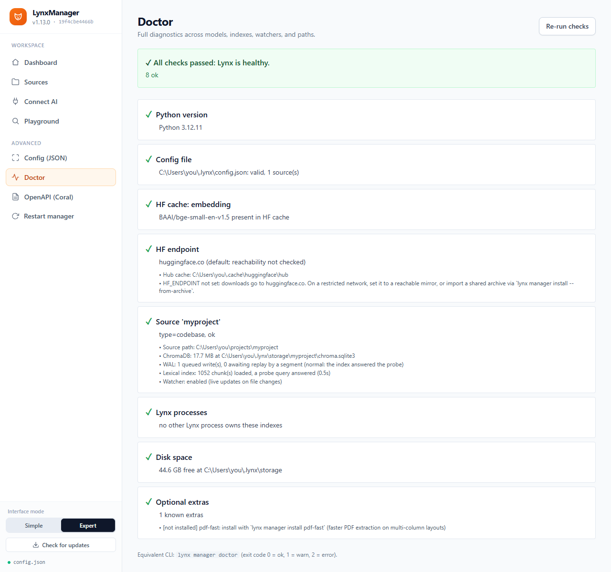

# Lynx: the full reference guide

This is the complete manual for Lynx (configuration, every source type,
the manager UI, retrieval internals, troubleshooting). For a quick
overview and the 3-command install, start from the
[README](../README.md).

> **Tool naming (v1.0):** the MCP tool set is fixed and does not grow with
> the number of sources. Tools take a `source` argument
> (`search(query, source="myproject")`); graph operations are bundled into
> one `graph_query(operation, symbol, ...)` tool. Earlier versions
> generated per-source names like `search_<name>` / `get_callers_<name>`.
> If you have an old rules file, regenerate it from the manager UI.

> **License:** [Apache 2.0](../LICENSE)

---

## Table of contents

1. [What this does](#what-this-does)
2. [Why it exists](#why-it-exists)
3. [Install Lynx](#install-lynx)
4. [Prerequisites](#prerequisites)
5. [LynxManager: guided setup, web UI, diagnostics (new in v0.9)](#lynxmanager-guided-setup-web-ui-diagnostics-new-in-v09)
6. [Configuration](#configuration)
7. [Migrating from v1 (single-source) configs](#migrating-from-v1-single-source-configs)
8. [Build the index for the first time](#build-the-index-for-the-first-time)
9. [Multi-source: indexing code AND library documentation](#multi-source-indexing-code-and-library-documentation)
10. [Webdoc sources](#webdoc-sources)
11. [PDF sources](#pdf-sources)
12. [Connect it to your AI client](#connect-it-to-your-ai-client)
    - [Claude Code (CLI)](#claude-code-cli)
    - [Claude Code extension for VS Code](#claude-code-extension-for-vs-code)
    - [Google Antigravity](#google-antigravity)
    - [Cursor](#cursor)
    - [Continue.dev / Aider / other MCP-compliant clients](#continuedev--aider--other-mcp-compliant-clients)
13. [Command-line interface](#command-line-interface)
14. [Verify the integration works](#verify-the-integration-works)
15. [The MCP tools you get](#the-mcp-tools-you-get)
16. [Get the most out of it: AI integration rules](#get-the-most-out-of-it-ai-integration-rules)
17. [Keeping the index up to date](#keeping-the-index-up-to-date)
18. [AST-aware chunking](#ast-aware-chunking)
19. [Hybrid retrieval](#hybrid-retrieval)
20. [Reranking (opt-in)](#reranking-opt-in)
21. [Graph layer (opt-in)](#graph-layer-opt-in)
22. [Config drift detection](#config-drift-detection)
23. [How it works (in 30 seconds)](#how-it-works-in-30-seconds)
24. [Architecture](#architecture)
25. [Restricted networks and air-gapped machines](#restricted-networks-and-air-gapped-machines)
26. [Troubleshooting](#troubleshooting)
27. [Contributing](#contributing)
28. [Privacy guarantees](#privacy-guarantees)

---

## What this does

When an AI assistant has to answer questions about a codebase larger than its
context window, it has two options: read files almost at random hoping to find
what it needs, or ask you. Neither is great.

This server fixes that. You configure N **sources** in `config.json` (a
codebase, a folder of library docs, a vendor reference dump, ...). For
each source the server auto-generates the right set of MCP tools at boot.

### Search tools

Two search tools (a fixed set: they take a `source` argument and are not
generated per source). `search` is in every tool profile, `deep_search` from
`standard` up; see [Tool profiles](#tool-profiles).

| Tool | What it does |
|---|---|
| `search(query, top_k, ...)` | Default semantic search over that source. Hybrid retrieval (dense + BM25 + RRF), one query. |
| `deep_search(queries, ...)` | Fallback for the same source. Tries several query variants in order and stops at the first strong result. Use it when `search` came back weak or empty. |

Plus the global, cross-source tools:

| Global tool | What it does |
|---|---|
| `list_sources()` | Enumerate configured sources with type, path, chunk count, drift status. |
| `search(query, ...)` | Run the query against every source in parallel and fuse rankings via RRF. Use when you don't know which source has the answer. |
| `deep_search(queries, ...)` | Multi-query × multi-source fallback. Use sparingly: it runs N×M retrievals. |
| `update_source_index(source, force)` | Re-check one source's files and re-index what changed. |
| `get_rag_status(source?)` | Report state of one source or all. |

When you ask the AI *"how is damage handled in this codebase?"* with a
source named `myproject`, it calls `search("damage handling")`, gets back
the top-K most relevant snippets across files, whatever the naming
conventions, and answers from that context. With multiple sources, it
picks the right tool based on the docstring of each `search`.

### Opt-in: structural understanding (graph layer)

Search tells you *where* something is. The optional **graph layer** tells
you *how things are connected*. Add `graph: { enabled: true }` to a
codebase source in `config.json` and 9 extra graph operations come online,
all under the single `graph_query(operation, ...)` tool:

| `graph_query` operation | What it answers |
|---|---|
| `graph_query("callers")(symbol)` | "Who calls X?" |
| `graph_query("callees")(symbol)` | "What does X call?" |
| `graph_query("subclasses")(symbol)` | "What concrete types extend / implement X?" |
| `graph_query("superclasses")(symbol)` | "What does X inherit from?" |
| `graph_query("imports")(file_or_symbol)` | "What does this file depend on?" |
| `graph_query("neighbors")(symbol, ...)` | "Show me everything around X" (BFS, optional relation filter) |
| `graph_query("shortest_path")(source, target)` | "How does A reach B in the call graph?" |
| `graph_query("overview")()` | "What are the main abstractions?" (god nodes + community detection) |
| `graph_query("surprising_connections")()` | Bridge edges between distant clusters (god-class antipatterns) |

Plus `graph_query("status")()` for diagnostics. None of these are registered
when the flag is off, so existing configs behave as before. See the [Graph
layer](#graph-layer-opt-in) section for how cross-file resolution,
inheritance edges, and persistence work.

### Codebase tools: navigate, understand, visualize

When a **codebase** source is present, these fixed-name tools come online (each
takes an optional `source`). Some compose the primitives above into one call so
the AI doesn't have to orchestrate several; the *(graph)* ones need the graph
layer enabled for the source.

| Tool | What it answers |
|---|---|
| `find_definition(symbol)` | Where is X defined? The first match comes with its body, the others with their signature. (AST-precise with the graph, BM25 fallback otherwise.) |
| `find_usages(symbol)` | Every use of X: calls, subtypes, and the textual references that contain the name as a word, with their lines. |
| `find_tests_for(symbol)` | Which tests exercise X? With the graph, also the tests that reach X through other calls without naming it, marked `[dN]`. |
| `find_similar(snippet)` | Does code like this already exist? (pure semantic) |
| `describe_symbol(symbol)` | One-shot context for X: its code + callers + callees + tests, in a single call. For a class: its bases, subtypes and the signatures of its members instead of the body. |
| `impact(symbol)` *(graph)* | Blast radius: everything that reaches X transitively through the call graph (with hop distance) + the tests to re-run. |
| `module_summary(file)` | A file as a unit: each symbol it defines with its signature and doc line; with the graph, also what it imports and which files depend on it. |
| `repo_overview()` | Orientation map: detected languages, frameworks, manifests, likely entry points, and build/test/run commands. A pure filesystem scan, no graph needed. Call it once when you land in an unfamiliar repo. |
| `export_graph(target, mode?)` *(graph)* | Render a shareable, offline graph view as a single self-contained file: a symbol's blast radius (`mode=symbol`) or a file hub (`mode=module`). Writes to `reports_path` (default `<storage>/reports`). Also available as a CLI: `lynx graph export --symbol … \| --module …`. |
| `search_diff(query, base?)` | Search only files changed vs a base branch, built for code review. (needs `git_integration`) |

Every one of these is also a command: replace the underscores with hyphens
(`find_definition` → `lynx find-definition ApplyDamage`) and you get the
same answer, rendered by the same code. See
[Command-line interface](#command-line-interface).

`export_graph` draws the call graph, so, like `graph_query`, it is
registered only when the graph layer is on. It is also the one tool here
that *writes* (a report file); the rest are read-only. `module_summary`
works without the graph from the file's own chunks.

Paths in every answer are relative to the source root
(`Assets/Scripts/Combat/Bullet.cs`): a bare file name is ambiguous in a
large tree, and an absolute one repeats the same prefix on every line. The
JSON of the HTTP API keeps the absolute `file` / `file_path` and adds
`rel_path` next to them.

## Why it exists

Modern AI IDEs (Cursor, Copilot, etc.) ship their own indexing, but with
trade-offs that are awkward for many teams:

- They upload your code to vendor servers to compute embeddings.
  For codebases under NDA, in regulated industries, or with sensitive IP,
  this is a hard blocker.
- They are vendor-specific. Switch IDE and you lose the index. Use
  multiple IDEs and you maintain multiple indexes.
- Their retrieval is implicit. The IDE decides when to retrieve and what.
  You can't deliberately ask "before writing this, search for anything
  similar that already exists."

This project addresses all three:

- Zero data egress. Embeddings are computed on your CPU using an open
  model. ChromaDB stores vectors on local disk. Nothing leaves the host.
- Vendor-neutral. Built on the open MCP protocol, so it works with any
  MCP-compliant client.
- Explicit retrieval. The assistant invokes the `search` tools
  deliberately, and project rules files let you bias *when*.

## Install Lynx

Download one file and open it. No terminal, no Python, nothing to set up.

### 🍎 Mac

1. Download `Lynx-…-macos.dmg` from the
   [Download page](https://github.com/lorenzo-cambiaghi/LynxMCP/releases/latest).
2. Open the downloaded file, then drag the Lynx icon onto the
   Applications folder.
3. Open Applications and double-click Lynx.
   - The first time, your Mac may say *"Lynx can't be opened because it's from
     an unidentified developer."* This is normal and safe. Instead of
     double-clicking, right-click the Lynx icon, click **Open**, then click
     **Open** again. (Only needed the first time; after that just double-click.)
4. A window opens and sets everything up by itself (a few minutes; leave it
   running). When it's done, Lynx opens in your web browser.

### 🪟 Windows

1. Download `Lynx-Setup-…exe` from the
   [Download page](https://github.com/lorenzo-cambiaghi/LynxMCP/releases/latest).
2. Double-click the downloaded file.
   - If a blue box says *"Windows protected your PC"*, this is normal and safe.
     Click **More info**, then **Run anyway**.
3. Click **Next / Install** until it finishes, then open Lynx from the Start
   Menu (or the desktop icon).
4. A window opens and sets everything up by itself (a few minutes; leave it
   running). When it's done, Lynx opens in your web browser.

<br>

<details>
<summary><b>Are you a developer? Click here for the command-line install (pipx / uv / dev clone).</b></summary>

<br>

### Recommended (CLI): a one-line install with `pipx` or `uv tool`

If you just want to use Lynx (not hack on it), install it as a
standalone CLI tool. Both `pipx` and `uv tool` create an isolated
virtualenv per tool and put the `lynx` command on your system PATH,
so it works from any folder, in any shell, on any platform, without
`source .venv/bin/activate`, `python -m`, or absolute paths.

```bash
# pipx: the established "install a Python CLI globally" tool.
# macOS / Linux: `brew install pipx` (or `python -m pip install --user pipx`)
# Windows:       `py -m pip install --user pipx`
pipx install lynx-mcp

# or uv (faster, same end result):
# Install uv first: see https://docs.astral.sh/uv/getting-started/installation/
uv tool install lynx-mcp
```

After either of those, `lynx` works from anywhere:

```bash
lynx --version
lynx manager init   # writes default config + pre-downloads embedding model
lynx manager ui     # opens the web panel; add your sources from there
```

(When LynxMCP lands on PyPI the source URL becomes just `lynx`, e.g.
`pipx install lynx-mcp`.)

To upgrade later: `pipx upgrade lynx` (or `uv tool upgrade lynx`).
To uninstall: `pipx uninstall lynx` (or `uv tool uninstall lynx`).

### Zero-terminal launch (for beginners)

If you have cloned the repository and prefer not to use the command line every time, Lynx comes with double-click launchers that automatically find your installation and open the web UI:
- **Windows:** Double-click `LynxManager.bat`
- **macOS / Linux:** Double-click `LynxManager.command` (from Finder)

The scripts start the server and open your browser. If `lynx` isn't installed yet, they walk you through installing it.

### Development install (editable from a clone)

Use this only if you want to modify Lynx's source code and have
your changes take effect immediately:

```bash
git clone https://github.com/lorenzo-cambiaghi/LynxMCP.git
cd LynxMCP

# pick ONE of these:
python -m venv .venv && source .venv/bin/activate     # macOS / Linux
python -m venv .venv && .venv\Scripts\activate        # Windows
# OR with uv:  uv venv && source .venv/bin/activate

pip install -e .     # or: uv pip install -e .
```

In this mode the `lynx` command exists at `.venv/bin/lynx` (or
`.venv\Scripts\lynx.exe` on Windows) and is on PATH only while the
venv is activated. If you forget to activate, you'll see
`command not found: lynx`. Three ways out:

1. Activate the venv: `source .venv/bin/activate` (then plain `lynx ...` works).
2. Use the full path: `.venv/bin/lynx manager ui`.
3. Use the explicit module form: `.venv/bin/python -m lynx manager ui`.

For everyday use, `pipx`/`uv tool` (above) is much nicer: no
activate-the-venv ritual at all.

> On Python 3.14+ you may also need: `pip install "mcp[cli]"`

Dependencies installed automatically:

| Package | Why |
|---|---|
| `mcp` | The MCP SDK (FastMCP server framework) |
| `llama-index-core` | Document loading, chunking, retrieval pipeline |
| `llama-index-vector-stores-chroma` | Adapter for ChromaDB |
| `onnxruntime`, `tokenizers` | Run the embedding model (and the optional reranker) on CPU. No PyTorch in the install. |
| `huggingface_hub` | Fetches the model files into the local HF cache, once |
| `chromadb` | Persistent vector database (sqlite-backed) |
| `gitpython` | Optional: detect new commits for the rebuild fallback |
| `watchdog` | Cross-platform file system events for live updates |
| `rank-bm25` | Lexical (BM25) retrieval used by the hybrid search mode |

Verify the install:

```bash
lynx --version
lynx --help
```

> ### ⚠️ Two equivalent ways to invoke (read this once)
>
> Throughout this README every example uses the short form
> `lynx ...`. The fully equivalent long form is
> `python -m lynx ...`. Pick whichever works for you:
>
> | Use the short form... | Use `python -m ...` instead when... |
> |---|---|
> | The `lynx` command is on your `PATH`. | The console script is missing or not on `PATH` (common on Windows: pip prints a warning at install time when `Scripts/` is not in `PATH`). |
> | You want shorter snippets in IDE config files. | You want a guaranteed-working invocation regardless of `PATH`. Recommended for IDE configs that you'll share or commit to dotfiles. |
>
> Side-by-side, all of these are interchangeable:
>
> ```bash
> lynx --help
> python -m lynx --help
>
> lynx build --config /path/to/config.json
> python -m lynx build --config /path/to/config.json
>
> lynx serve --config /path/to/config.json
> python -m lynx serve --config /path/to/config.json
> ```
>
> If you're on Windows and the short form fails with "command not found",
> just prefix the invocation with `python -m`. That's the only difference.

</details>

---

## Prerequisites

- Python 3.10+ and pip (only for the CLI install; the standalone Mac/Windows apps do not need Python).
- ~500 MB of disk space for the embedding model (downloaded once on first run)
- An MCP-compliant AI client: Claude Code CLI, Claude Code extension for
  VS Code, Antigravity, Cursor, Continue.dev, Aider, etc.

> **First-run note:** the embedding model (`BAAI/bge-small-en-v1.5`, ~130 MB)
> is downloaded once from HuggingFace on the very first run. After that,
> offline mode is enforced and no network calls are made.

---

## LynxManager: guided setup, web UI, diagnostics (new in v0.9)

If you'd rather not hand-edit a JSON file and read through the
configuration section that follows, `lynx manager` covers the entire
lifecycle in four commands. This is the recommended on-ramp for new
users. Everything stays local: no telemetry, no cloud, the same privacy
guarantees as the rest of Lynx.

### `lynx manager init`: minimal bootstrap

```bash
lynx manager init
```

Does the one thing the web UI can't do for itself: writes a default
`config.json` (with an empty `sources: {}`) and pre-downloads the
embedding model (`BAAI/bge-small-en-v1.5`, ~130 MB) into your local
HuggingFace cache. That's it. No per-source Q&A, no AI-client picker.
The only prompt is "Open LynxManager now?" at the end (default Y);
say yes and the UI opens in your browser, ready to add sources.

The original wizard chained 15+ prompts with opaque choices
(`reranker enabled?`, `pdf backend?`, `search mode hybrid / dense /
sparse?`). All of that moved into the UI, where each option is a form
field with multi-line help text and a visual folder picker, instead of
a one-line terminal prompt the user can't evaluate at first contact.

Flags:

- `--output PATH`: where to write the config (default `./config.json`).
- `--non-interactive`: skip both prompts (overwrite-confirm + open-UI);
  used by CI / scripts.
- `--skip-model-download`: don't pre-fetch the embedding model. It is
  downloaded lazily on the first `lynx serve` query instead.

After init, add your first source either way: open the UI and click
**+ Add source** (see `lynx manager ui` below for the guided form), or
stay in the terminal with
[`lynx source add`](#source), which runs the same validation without a browser:

```bash
lynx manager init --non-interactive
lynx source add myproject --type codebase --path /path/to/repo --build
```

### `lynx manager doctor`: full diagnostic



```bash
lynx manager doctor
```

Runs seven checks in parallel and prints a colour-coded report: Python
version, HuggingFace cache (per declared model), HuggingFace endpoint
(mirror / offline mode), config file validity, per-source state (path exists, ChromaDB collection healthy, drift
status, watcher path still there), optional extras (which are installed
vs available), and free disk space at the storage path. Exit code is
`0` (all green), `1` (warnings), or `2` (errors) so you can wire it
into CI / pre-deploy scripts.

Two flags repair an index in place, without a full rebuild. Both
refuse to run while any Lynx process holds the store, so stop `serve`
and the web UI first:

```bash
# A process killed mid-write (Ctrl-C during indexing, a killed serve) left
# ChromaDB's write-ahead log wedged: every open hangs and the integrity
# probe times out at each start. Purges the stuck writes and queues the
# affected files for re-indexing; nothing is silently lost.
lynx manager doctor --heal-wal <source>

# The SHA cache lists files as indexed but the index holds no chunks for
# them, or chunks whose vector never reached the HNSW segment (a failed
# insert used to be recorded as success, so those files were skipped on
# every later pass and invisible to search). Forgets just those files so
# the next build / watcher pass re-indexes them.
lynx manager doctor --heal-coverage <source>
```

The per-source check reports both conditions ("index WAL is wedged" and
coverage drift) together with the flag that fixes them, so you never have
to diagnose them yourself.

### `lynx manager install`: extras + model download

```bash
# What extras are available / installed?
lynx manager install --list

# Install an extra (installs the packages behind the extra)
lynx manager install pdf-fast

# Download the configured embedding model explicitly
lynx manager install --model

# ...and the reranker model too
lynx manager install --model --with-reranker
```

The `--model` path temporarily bypasses `HF_HUB_OFFLINE` /
`TRANSFORMERS_OFFLINE` so you can force a download even when
runtime offline mode is on. Useful when prepping an air-gapped machine.

### `lynx manager ui`: local web panel

A small web app that runs on your own machine and lets you click
through everything Lynx can do; no command line needed past the launch.
Useful when you've just set Lynx up and want to check it works
before wiring it into your AI client.

#### Step 1: launch it

The fastest way is to double-click the launcher in the repo.

- **macOS**: double-click `LynxManager.command` in Finder. (First time
  only: right-click → Open → Open to clear the Gatekeeper warning, since
  the file isn't notarized.)
- **Windows**: double-click `LynxManager.bat` in Explorer. (First time
  only: SmartScreen may prompt; click "More info" → "Run anyway".)

A console window opens, the UI boots, and your browser is pointed at
`http://127.0.0.1:8765`. To stop it, press `Ctrl+C` in the console
window (or just close the window).

The launcher detects whichever install style you used (`pipx`, `uv tool`,
local `.venv`, or `python -m lynx`) and runs the matching one, so the
same file works for end users and developers.

Or, from a terminal in the folder where your `config.json` lives:

```bash
lynx manager ui
```

When you don't pass `--config`, Lynx uses the same resolution chain as
`lynx serve`: explicit flag → `RAG_CONFIG_PATH` env var → `./config.json`
in the current working directory. On Windows that means PowerShell /
cmd.exe / Git Bash all need to be launched from the folder that
contains `config.json` (or you pass the full path):

```bash
# Windows PowerShell / cmd.exe / Git Bash: point at it explicitly if
# you don't want to cd first:
python -m lynx manager ui --config C:\Users\you\projects\myrepo\config.json
```

> If your config sits elsewhere, point at it explicitly:
> `lynx manager ui --config /full/path/to/config.json`
>
> The terminal output tells you which config file was picked up and
> when the embedding model has finished loading. That catches "I
> thought I was in the right folder" mistakes and explains the brief
> startup pause on first launch:
> ```text
> [ui] using config: /home/you/myrepo/config.json
> [ui] loading embedding model + opening source collections (first launch can take 30s)...
> [ui] manager ready in 4.2s (2 sources).
> 🐱 Lynx UI ready at http://127.0.0.1:8765
> ```
> The browser only opens after the manager is ready, so the page
> loads at once instead of hanging on a white screen while
> `BAAI/bge-small-en-v1.5` warms up in the background.

You'll see something like this in the terminal:

```text
🐱 Lynx UI ready at http://127.0.0.1:8765
   Press Ctrl+C to stop.
```

About half a second later your default browser opens on that URL and
you land on the LynxManager dashboard.

> **Browser didn't open?** Some setups (SSH sessions, minimal Linux
> desktops, certain WSL configurations) can't launch a browser
> automatically. Copy the URL (`http://127.0.0.1:8765`) and paste it
> into any browser tab on the same machine. It works the same way.
>
> **Port already in use?** Lynx tries the next 10 ports automatically
> (`8766`, `8767`, …) and prints whichever one it landed on. If you
> want a specific port, pass `--port 9000`.
>
> **Want to launch without opening a browser?** Use
> `lynx manager ui --no-browser` (handy when you're remoting in).
>
> **To stop it,** go back to the terminal and press `Ctrl+C`.

The UI listens only on `127.0.0.1`, so it is not reachable from other
machines on the network. There's no login because there's no need: nobody
else can reach it.

#### Step 2: a tour of the pages

[LynxManager, step by step](MANAGER.md) walks through the interface with
pictures of the current version: the first launch, adding a project, a
first search, connecting your editor, and the Expert pages. The pictures
are taken from the running UI by `scripts/manager_guide.py`, so they match
the release they ship with.

You can leave the UI open next to a running `lynx serve`; they share the
index, and only the one that owns it does the indexing (see
[Keeping the index up to date](#keeping-the-index-up-to-date)).

#### What each page does (reference)

- **Dashboard**: per-source cards with chunk count, drift severity,
  lock badge (set when another process is mid-write on the same
  ChromaDB), plus a doctor summary.
- **Sources**: list + per-source detail page with a rebuild button
  that runs `manager.update(src, force=True)` in a daemon thread; the
  HTMX widget self-polls every second until the job is terminal.
  Reading a source another process owns is fine, so the UI searches it
  normally; rebuilding it from here is not, and the button answers 409
  naming the process that does the indexing.
- **Playground**: tabbed forms for every tool the MCP server exposes:
  `search` and `deep_search`; `find_definition` / `find_usages` /
  `find_tests_for` / `find_similar`; the composed `describe_symbol`,
  `impact`, `module_summary` and `repo_overview`; all ten `graph_query`
  operations behind one operation selector; `export_graph`, which writes a
  shareable view and links straight to it; and `search_diff`. Faster than
  spinning up a client to validate that a query works.

  The composed tools and the graph operations show their output verbatim,
  in the same text your AI client receives. The point of a playground is to
  see what the agent sees, so tuning a source means reading the real
  answer rather than a prettier rendering of it.
- **Feedback** (dashboard card): the reports your AI clients filed when
  they exhausted search and still couldn't find what they needed. Each one
  names a source, a filter or a chunking setting worth a second look. Local
  file, never uploaded; `lynx manager feedback` prints the full log.
- **Config**: JSON editor with backup-then-overwrite save and the
  same validation the CLI uses (validates to a tempfile before
  touching the real config).
- **Integrations**: per-client cards (Claude Code, Cursor,
  Antigravity, generic stdio) with the MCP JSON snippet pre-populated
  using *your* interpreter + *your* config path, copy-to-clipboard
  button, and one-click download of the generated `CLAUDE.md` /
  `AGENTS.md` / `lynx.md` rules file.

#### Notes on scope

Auth and HTTPS are out of scope: this is a personal
management tool, not a shared service. Bind is `127.0.0.1` only. To
disable the auto-browser-open use `--no-browser`. To pick a different
port use `--port`. If the port is busy it advances up to 10 slots
before letting the OS assign one.

---

## Configuration

> **New in v0.9:** prefer the web UI's **+ Add source** flow over
> editing JSON by hand. `lynx manager init` bootstraps an empty config;
> `lynx manager ui` opens a guided form for each source type (codebase /
> web docs / PDFs) with inline help for every option and a visual folder
> picker. The reference below stays authoritative for advanced cases
> (multi-source, custom rerankers, watcher tuning).

The config is a single JSON file with shared settings at the top level
and a `sources` block that lists everything to index. Copy the example and
edit it:

```bash
cp config.example.json config.json
```

Minimum useful config (single source):

```json
{
  "config_version": 2,
  "storage_path": "./rag_storage",
  "loading_timeout_seconds": 600,
  "embedding": { "model_name": "BAAI/bge-small-en-v1.5" },
  "search": {
    "default_top_k": 8,
    "mode": "hybrid",
    "rrf_k": 60,
    "candidate_pool_size": 30,
    "deep": {
      "min_results": 2,
      "score_thresholds": { "dense": 0.45, "hybrid": 0.012, "sparse": 3.0 }
    }
  },
  "sources": {
    "myproject": {
      "type": "codebase",
      "path": "C:/path/to/your/codebase",
      "supported_extensions": [".py", ".md", ".js", ".ts"],
      "ignored_path_fragments": ["/.git/", "/node_modules/"],
      "watcher": { "enabled": true, "debounce_seconds": 2.0 },
      "git_integration": { "enabled": true }
    }
  }
}
```

### Top-level (shared across every source)

| Field | What it does |
|---|---|
| `config_version` | **Required.** Must be `2`. Use `lynx migrate-config` to upgrade an older config. |
| `storage_path` | Where per-source ChromaDB folders live (each at `<storage_path>/<source_name>/`). Relative paths are resolved against the config file's directory. Default `./rag_storage`. |
| `loading_timeout_seconds` | The handshake never waits for the indexes: they open in the background and a tool call that arrives earlier answers with the loading state after at most 20 seconds (`LYNX_TOOL_WAIT_SECONDS`). Past this many seconds of loading, that answer adds a warning, because a first-run build of a large repository can take minutes. Default `600`. |
| `embedding.model_name` | A HuggingFace repo that ships an ONNX export (`onnx/model.onnx`): the BGE family (`BAAI/bge-small-en-v1.5`, `bge-base-en-v1.5`, `bge-m3`), `sentence-transformers/all-MiniLM-L6-v2`, or a local folder exported with `optimum-cli export onnx`. Changing this invalidates all existing vectors across every source; see [Config drift detection](#config-drift-detection). |
| `tools.profile` | `core`, `standard` (default) or `full`: which MCP tools `lynx serve` registers. `tools.include` / `tools.exclude` add or remove single tools by name. See [Tool profiles](#tool-profiles). |
| `search.default_top_k` | Default number of chunks the `search` tool returns when `top_k` is not passed. |
| `search.mode` | `"hybrid"` (default), `"dense"`, or `"sparse"`. See [Hybrid retrieval](#hybrid-retrieval). |
| `search.rrf_k` | Reciprocal Rank Fusion constant (default `60`). |
| `search.candidate_pool_size` | Per-retriever candidate pool size (default `30`). |
| `search.secondary_weight` | The fused score of test, data and doc files (`*.test.*`, `*.spec.*`, `tests/`, `__tests__/`, `*.json`, `*.md` and the like) is multiplied by this, so the code a question is about ranks above the tests and data that tell the same story in plain words. Default `0.5`; `1.0` turns it off. On a 214k-line TypeScript game it took the right file from first place in 4 of 76 issue titles to 19. |
| `search.deep.min_results` | For `deep_search`: minimum results required for a variant to count as "strong" (default `2`). |
| `search.deep.score_thresholds` | Mode-specific "weak" thresholds. Defaults: `dense=0.45`, `hybrid=0.012`, `sparse=3.0`. |

### Per-source (one entry under `sources`)

Source names must match `^[a-zA-Z][a-zA-Z0-9_]{0,39}$`: a letter, then letters
/ digits / underscores. The name is used verbatim in the auto-generated
tool names (`search`, `deep_search`), so pick something the AI
client will recognise in its tool list (e.g. `myproject`, `unityDoc`,
`avalonia_docs`).

| Field (codebase type) | What it does |
|---|---|
| `type` | **Required.** `"codebase"` for a local directory of files. Other supported types: `"webdoc"` (see [Webdoc sources](#webdoc-sources)) and `"pdf"` (see [PDF sources](#pdf-sources)). |
| `path` | **Required.** Absolute path of the directory to index. |
| `supported_extensions` | File extensions to include (e.g. `[".py", ".md"]`). Anything else is ignored. |
| `ignored_path_fragments` | Substrings: any path containing one is left out of the index, the graph and the watcher (forward slashes are auto-normalized). A directory matching one is not even walked. |
| `ignored_globs` | Glob patterns for files to leave out, such as `["**/20??-??-??-*.txt"]` for dated chat transcripts. Without a slash a pattern matches the file name; with one, the path relative to `path`, where a leading `**/` also matches at the top. Searches drop excluded files at once; the next build removes them from the index. |
| `watcher.enabled` | Set to `false` to disable the live file watcher for this source. |
| `watcher.debounce_seconds` | Time to wait after a save before re-indexing. Default `2.0`. |
| `git_integration.enabled` | When `true`, drift / status reports include the last indexed git commit for this source. |
| `language` | What the code and its comments are written in, as two-letter ISO 639-1 codes, such as `{"code": "en", "comments": "it"}`. Both default to English. Lynx tells the agent at startup to write its search queries in the code's language, whatever language you write to it in: a query in another language finds little. Set it when the code or its comments are not in English. |

To use a different config location, three options in priority order:

1. Pass `--config /absolute/path/to/config.json` to any CLI subcommand.
2. Set the environment variable `RAG_CONFIG_PATH` to an absolute path.
3. Default: `./config.json` in the current working directory.

For MCP IDE integration, option (1) is the recommended one; see the
[Connect it to your AI client](#connect-it-to-your-ai-client) snippets.

---

## Migrating from v1 (single-source) configs

The v0.1.x line used a flat schema with `codebase_path` at the top level and
no `sources` block. v0.2.0 introduced the multi-source schema documented
above. The migration is a one-liner:

```bash
lynx migrate-config --input config.json --source-name myproject
# writes config.v2.json next to the input
```

Review the generated file, then replace your old `config.json` with it (or
point your launcher at the new path via `--config` / `RAG_CONFIG_PATH`).
Your old `rag_storage/` is at the v1 layout (chroma data at the root) and
won't be read by v0.2. Delete it and run `build --source <name>` to rebuild
under the v2 per-source layout. A 1k-file codebase rebuilds in a few minutes.

The loader emits an explicit error pointing at this command if it sees a v1
config, so you'll never silently run with a stale schema.

---

## Build the index for the first time

The first index build can take a few minutes per source on a large codebase
(it scans every file and computes embeddings on CPU). To avoid making your
AI client wait the first time it connects, pre-build the index from a
terminal.

From the directory containing your `config.json`, run:

```bash
# When you have a single source, --source is optional:
lynx build

# When you have multiple sources, name the one you want:
lynx build --source myproject
lynx build --source unityDoc
```

> If you get `command not found`, use the equivalent `python -m` form:
> `python -m lynx build --source <name>`. See
> [Two equivalent ways to invoke](#install-lynx) for why.

You should see logs like:

```
[rag] Indexing codebase from C:\path\to\your\codebase...
[rag] Found 1247 files
Source 'myproject' ready.
```

If your `config.json` lives elsewhere, use `--config`:

```bash
lynx build --config /path/to/config.json --source myproject
```

The same `build` command also handles rebuilding later (e.g. after
changing the embedding model): it does a full forced rebuild whenever the
source already has an index.

> Note: starting the server with `lynx serve` on a fresh
> install will also trigger an initial build of every source implicitly.
> Pre-building is just a courtesy so the first MCP client doesn't have to
> wait minutes.

Each source has its own subdirectory under `storage_path/`:

```
rag_storage/
├── myproject/
│   ├── chroma.sqlite3
│   ├── metadata.json
│   └── owner.json          which session is doing the indexing
└── unityDoc/
    ├── chroma.sqlite3
    ├── metadata.json
    └── owner.json
```

Subsequent server starts are fast (seconds) once every configured source
has a populated `<source>/` subdir.

---

## Multi-source: indexing code AND library documentation

The primary use case for multi-source is keeping a local copy of library
documentation that the AI client doesn't know about, either because the
library updates faster than the model's knowledge cutoff (Unity, AvaloniaUI,
SDKs that ship every quarter) or because it's internal, niche, or not
indexed on the public web.

Configure each one as its own source. Example for a Unity gamedev with
local copies of two documentation sets in addition to their code:

```json
{
  "config_version": 2,
  "storage_path": "./rag_storage",
  "embedding": { "model_name": "BAAI/bge-small-en-v1.5" },
  "search": { ... },
  "sources": {
    "myproject": {
      "type": "codebase",
      "path": "C:/projects/mygame/Assets/Scripts",
      "supported_extensions": [".cs", ".md", ".shader"],
      "watcher": { "enabled": true, "debounce_seconds": 2.0 }
    },
    "unityDoc": {
      "type": "codebase",
      "path": "C:/vendor-docs/unity-6.2-manual",
      "supported_extensions": [".md", ".html", ".txt"],
      "watcher": { "enabled": false, "debounce_seconds": 2.0 }
    },
    "avalonia": {
      "type": "codebase",
      "path": "C:/vendor-docs/avalonia-docs",
      "supported_extensions": [".md", ".rst"],
      "watcher": { "enabled": false, "debounce_seconds": 2.0 }
    }
  }
}
```

This boots the server with the same fixed tool set regardless of how many
sources you configure:

```
search    deep_search    list_sources    get_rag_status
update_source_index    feedback
```

Plus, when a codebase source is present: `find_definition`,
`find_usages`, `find_tests_for`, `find_similar`, `describe_symbol`,
`impact`, `module_summary`, `repo_overview`, `search_diff`, and the
graph-only `graph_query` and `export_graph` when that source has
`graph.enabled=true`. Each tool takes a
`source` argument (omit it to fan out across all sources); the handshake
`instructions` describe every configured source so the AI client picks the
right `source`. Pair this with an AI integration rules file (see the
[section below](#get-the-most-out-of-it-ai-integration-rules)) to bias the
AI toward a given source for Unity API questions, etc.

> `type: "webdoc"` is available since v0.4: fetch a public docs
> site on demand, dump the extracted main content to a local folder,
> and index it through the same hybrid pipeline as code. See the
> [Webdoc sources](#webdoc-sources) section for the config schema and
> the refresh model. `type: "pdf"` is also available: point it at a local
> folder of PDFs and they go through the same pipeline (see the PDF
> sources section).

---

## Webdoc sources

Indexes a public documentation site by crawling it from a starting URL.
For libraries that update faster than the model's training cutoff
(Unity, AvaloniaUI, AWS SDKs, any framework with a quarterly release
cadence) this is the difference between the AI suggesting deprecated
APIs and the AI knowing what's there today.

### Configuration

```json
"sources": {
  "unityDoc": {
    "type": "webdoc",
    "url": "https://docs.unity3d.com/Manual/index.html",
    "max_depth": 3,
    "max_pages": 1000,
    "same_origin_only": true,
    "include_url_patterns": ["/Manual/"],
    "exclude_url_patterns": ["/Manual/Obsolete"],
    "request_delay_seconds": 0.5,
    "user_agent": "Lynx-DocFetcher/0.4"
  }
}
```

| Field | What it does |
|---|---|
| `type` | **Required.** `"webdoc"`. |
| `url` | **Required.** Starting URL of the crawl. Must be `http://` or `https://`. |
| `max_depth` | BFS depth limit from the starting URL. Default `3`. |
| `max_pages` | Hard cap on the number of pages fetched. Default `500`. |
| `same_origin_only` | If `true` (default), the crawler stays on the seed URL's hostname. |
| `include_url_patterns` | List of substrings; a URL must contain at least one to be saved. The seed URL is always visited (so its links can be discovered) but only added to the dump if it matches. |
| `exclude_url_patterns` | List of substrings; any URL containing one is skipped entirely. |
| `request_delay_seconds` | Polite delay between requests. Default `0.5` (= 2 req/sec). |
| `user_agent` | Optional override. Default identifies as `Lynx-DocFetcher/<version>`. |

### Fetch and refresh

A webdoc source is never auto-refreshed: detecting "the upstream
site changed" without re-downloading is unreliable (ETag / Last-Modified
support varies a lot). Refresh is always explicit:

```bash
lynx build --source unityDoc
```

This:
1. Crawls the configured URL (respecting depth, origin, filters)
2. Extracts main content from each HTML page using `trafilatura`
   (drops nav / footer / sidebars)
3. Writes one `.md` file per crawled URL to `storage_path/<source>/_dump/`,
   with a YAML frontmatter block containing the original URL and
   fetched-at timestamp
4. Wipes any old dump first so URLs no longer present upstream don't
   leave stale chunks
5. Triggers a full reindex through the same chunker + embedding pipeline
   used by codebase sources

Run it again whenever you want a fresh snapshot, typically after a
library version bump.

### What gets supported, what doesn't

| | Supported | Notes |
|---|---|---|
| Static HTML | ✅ | Sphinx, mkdocs, docusaurus, hand-written sites |
| Server-rendered SSR | ✅ | Anything that ships HTML directly |
| JS-rendered SPAs | ✅ opt-in | Set `render_js: true` on the source: pages load in headless Chromium (Playwright) so client-side rendering runs before extraction, and link discovery sees the post-JS DOM. Requires the `webdoc-js` extra (`lynx manager install webdoc-js`, downloads Chromium ~150MB). Roughly 10x slower per page than plain HTTP, so leave it off for server-rendered sites. Tunables: `render_wait_until` (`load` / `domcontentloaded` / `networkidle`, default `networkidle`) and `render_timeout_seconds` (default 30). |
| Auth-gated docs | ❌ | The crawler sends a plain UA, no cookie / token support. PRs welcome if you need it. |
| PDFs / images | ⚠️ not via crawl | The webdoc crawler skips any URL whose content-type isn't HTML. PDFs are fully supported, but through a separate `type: "pdf"` source pointed at a local folder of `.pdf` files (see the PDF source section), not by crawling them off a docs site. |
| robots.txt | ⚠️ Not consulted | Crawl is rate-limited and identifies itself, but currently doesn't parse robots.txt. Use `request_delay_seconds` to stay polite. |
| Partial / JS-rendered TOCs | ✅ with `render_js` | If the site's index page lists its sub-pages via JavaScript (Unity 6 ScriptReference is one example), the plain-HTTP crawler sees the static HTML only, with no link discovery past the seed. Enable `render_js: true` and the crawler discovers links from the rendered DOM; or, without the extra, point at a non-index page / sitemap URL as the seed. |

> **Windows TLS note.** Lynx ships with `truststore` as a dependency so the
> crawler reads the OS certificate store (Windows / macOS keychain / Linux
> ca-certificates) instead of certifi's Mozilla bundle. Without this, on a
> Windows machine inside a corporate / antivirus TLS proxy, the crawler
> would fail every fetch with `CERTIFICATE_VERIFY_FAILED`. If you've added
> custom trust to your Windows store, the crawler will respect it.

### Multi-source example: code + library docs together

```json
"sources": {
  "myproject": {
    "type": "codebase",
    "path": "C:/projects/mygame/Assets/Scripts",
    "supported_extensions": [".cs", ".md"]
  },
  "unityDoc": {
    "type": "webdoc",
    "url": "https://docs.unity3d.com/Manual/",
    "include_url_patterns": ["/Manual/"],
    "max_pages": 1500
  },
  "avalonia": {
    "type": "webdoc",
    "url": "https://docs.avaloniaui.net/",
    "max_pages": 800
  }
}
```

Boots the server with the fixed tool set. `search(query, source=...)` targets
one of `myproject` / `unityDoc` / `avalonia`, or omit `source` to search all
three at once (RRF-fused); `deep_search` works the same way. The handshake
`instructions` list each source's type, so your AI client picks the right
`source` based on the question.

---

## PDF sources

`type: "pdf"` indexes a folder of `.pdf` files (manuals, RFCs, normative
documents, white-papers, technical books). Lynx extracts text page by
page, writes one Markdown file per page under `_dump/`, then indexes
those via the same RAG pipeline used for codebases. Citations come back
as `User Manual.pdf p.42` thanks to YAML frontmatter on each page dump.

### Why a PDF source instead of converting upstream

Running `pdftotext` and putting the result in a codebase source works, but
you lose page numbers, you re-convert by hand whenever a PDF changes, and
each document becomes one giant blob of text. The PDF source keeps page
granularity, refreshes incrementally by SHA, and skips files it can't
handle.

### Configuration

```json
"sources": {
  "manuals": {
    "type": "pdf",
    "path": "C:/path/to/your/pdfs",
    "recursive": true,
    "file_glob": "**/*.pdf",
    "watcher": { "enabled": false, "debounce_seconds": 5.0 },
    "extractor": {
      "backend": "auto",
      "max_file_mb": 100,
      "max_pages_per_file": 5000,
      "skip_password_protected": true,
      "skip_if_text_empty": true
    }
  }
}
```

| Field | Default | What it does |
|---|---|---|
| `path` | **required** | Absolute path of the folder containing the .pdf files. |
| `recursive` | `true` | Walk sub-directories. Set `false` to limit to the top-level folder. |
| `file_glob` | `"**/*.pdf"` | `pathlib.Path.glob` pattern relative to `path`. Use e.g. `"datasheets/*.pdf"` to scope. |
| `watcher.enabled` | `false` | Off by default: re-extracting a PDF is costly (10-30s) and PDFs change rarely. When `true`, watchdog observes the source folder; new / modified / deleted PDFs trigger an incremental re-extract. |
| `extractor.backend` | `"auto"` | `"auto"` prefers `pymupdf` if installed, else `pypdf`. Force one with `"pypdf"` or `"pymupdf"`. |
| `extractor.max_file_mb` | `100` | Skip PDFs larger than this. RAM-safety: pypdf loads the whole file at ~3-5× disk size. Raise carefully. |
| `extractor.max_pages_per_file` | `5000` | Skip pathological documents (50k-page legal dumps generate millions of chunks). |
| `extractor.skip_password_protected` | `true` | When `true` (only valid value today), encrypted PDFs are skipped with `status="skipped_password"` in the state file. |
| `extractor.skip_if_text_empty` | `true` | When `true`, PDFs with less than 100 total extracted characters are skipped as "probably scanned" (Lynx has no OCR). |

### What is supported

| PDF type | Result | Notes |
|---|---|---|
| **Born-digital** (Word/LaTeX/web → PDF) | ✅ Works | ~90% of real-world technical PDFs. |
| **Multi-column papers** (academic / IEEE) | ⚠️ OK with `pypdf`, good with `pymupdf` | Reading order can be wrong with the default. Install `lynx[pdf-fast]` for these. |
| **Tables and forms** | ✅ Extracted as flattened text | Searchable but structure not preserved. |
| **Password-protected** | ❌ Skipped | Status `skipped_password`. Decryption with a password store is out of scope (for now). |
| **Scanned PDFs** (no text layer) | ❌ Skipped | Status `skipped_empty`. No OCR support: Tesseract would need system binaries + ~200 MB of models, which breaks the "100% local zero-deps" promise. Convert externally if you need them. |
| **Encrypted with DRM** | ⚠️ Sometimes works | DRM usually only blocks printing, not text extraction. Case-by-case. |
| **Files > 100 MB** | ❌ Skipped | Raise `extractor.max_file_mb` if you really need a 500 MB PDF. |

### Faster / better extraction (opt-in)

```bash
pip install "lynx-mcp[pdf-fast]"      # adds pymupdf (AGPL)
```

Then either let `extractor.backend: "auto"` pick it up, or pin it
explicitly with `"pymupdf"`. PyMuPDF is roughly 4× faster than pypdf
and noticeably better on multi-column layouts. We keep it opt-in because
its AGPL license is incompatible with Lynx's Apache 2.0 distribution.

### Re-extracting

Same UX as webdoc: explicit by default.

```bash
# Add / modify / remove PDFs in the folder, then:
lynx build --source manuals
```

When `watcher.enabled=true`, the same logic runs automatically on every
file-system event (debounced 5s by default). Look in
`<storage>/manuals/_extract_state.json` for the SHA cache + per-file
status (`ok`, `skipped_*`, `error`).

### What you see in `lynx status`

```
$ lynx status --source manuals
=== Source: manuals (type: pdf) ===
  pdf_count:            42
  skipped_count:         3   ← 2 password-protected, 1 scanned
  total_pages_extracted: 8451
  chunk_count:          9234
  extractor_backend:    pypdf
  last_extract_at:      2026-05-21T10:00:00
```

---

## Connect it to your AI client

The server speaks MCP over stdio. Every modern AI client supports it, and
configures it the same way: a `command` to launch the server, an array of
`args`, and optionally `env` and `cwd`.

In every example below, replace `C:/path/to/lynx` with the
absolute path where you cloned this repo.

> Tip on Windows: in JSON, you can use either forward slashes (`C:/Users/...`)
> or escaped backslashes (`C:\\Users\\...`). Forward slashes are simpler.

All snippets below assume the package is installed (`pip install -e .` from
the repo, or eventually `pip install lynx-mcp`) and that you
have a `config.json` somewhere on disk.

> **Startup.** `lynx serve` answers `initialize` in about a second; the
> embedding model, the Chroma stores, the BM25 corpora and the graph open in
> a background thread. A tool call that arrives before they are ready waits
> up to 20 seconds, then answers with what is happening ("still opening its
> indexes (opening 2 sources, 7s so far). Retry this call in a few seconds.")
> so the agent retries instead of the client timing out. On a first run,
> when the index does not exist yet, that is how you see the build progress
> from inside the client; `lynx build` beforehand avoids the wait entirely.
>
> **Passing the config.** An MCP client launches the server from an
> unpredictable working directory, so always pass `--config` with an
> absolute path. Replace `C:/path/to/config.json` in every snippet with
> your actual path.

> **If the short command isn't on your `PATH`.** Every snippet below
> uses `"command": "lynx"`. If pip installed the console
> script outside your `PATH` (common on Windows; pip prints a warning at
> install time), swap the entry for the equivalent `python -m` form:
>
> ```json
> "command": "python",
> "args": ["-m", "lynx", "serve", "--config", "C:/path/to/config.json"]
> ```
>
> The two behave identically. For shared or committed config files the
> `python -m` form is the safer default, because it does not depend on
> the user's `PATH`.

### Claude Code (CLI)

Add the server with one command:

```bash
claude mcp add codebase-rag --scope user -- lynx serve --config C:/path/to/config.json
```

Or edit `~/.claude.json` (or `%USERPROFILE%\.claude.json` on Windows) directly:

```json
{
  "mcpServers": {
    "codebase-rag": {
      "command": "lynx",
      "args": ["serve", "--config", "C:/path/to/config.json"]
    }
  }
}
```

Restart Claude Code. The next session lists the tools of the profile you
chose (see [Tool profiles](#tool-profiles)); the tool set does not grow with
the number of sources.

#### One server for every session

Over stdio each Claude Code session starts its own server, with its own copy
of the indexes in memory. On a large repository that adds up: a server on a
1.4-million-line library held 2 to 3.7 GB. With many sessions or agents
running at once, start one server over HTTP and point them all at it:

```bash
lynx serve --http 8791 --config C:/path/to/config.json
lynx connect claude --url http://127.0.0.1:8791/mcp
```

The server listens on the loopback interface only. `connect --url`
registers it at user scope and adds the prompt hook as usual. Keep the
server running while sessions use it: a session started while it is down
lists Lynx as failed until `/mcp` reconnects it.

#### The prompt hook

Claude Code with Lynx connected still tends to explore with grep and cat,
and calls Lynx late or not at all. The prompt hook does not wait for that
choice. On every request, Claude Code calls the `prompt_hook` tool of the
Lynx server it is already running and passes it the prompt. Lynx runs one
search per sentence and answers with a map of the code the request is
about: up to 12 places, each with file, lines and signature, about 1,300
characters. The map reaches the model before its first turn.

`lynx connect claude` installs the hook in `~/.claude/settings.json`;
`--no-hook` leaves it out, and `--disconnect` removes it with the server.
By hand, in `~/.claude/settings.json` or in a project's
`.claude/settings.json`:

```json
{
  "hooks": {
    "UserPromptSubmit": [
      {"hooks": [{"type": "mcp_tool", "server": "lynx", "tool": "prompt_hook",
                  "input": {"prompt": "${prompt}"}}]}
    ]
  }
}
```

`server` is the name you gave the server in `claude mcp add` (`codebase-rag`
in the example above). With the index open the hook takes 150 to 450 ms per
prompt. A prompt with no sentence of four words or more ("yes", "go on")
gets no map, and a failure (the index still opening, a broken store) adds
nothing to the context rather than an error.

The tool must answer hook JSON (`hookSpecificOutput.additionalContext`):
Claude Code drops the plain-text answer of an `mcp_tool` hook. Measured on
a three.js game of 8,600 lines, two bug fixes from real issues, the hook
made each run read less, write less and need fewer API calls (10 instead of
12 to 15). On a game of 214,000 lines, where every task named the code it
was about, it saved nothing measurable: grep found the file in two to four
calls anyway, and a map that pointed elsewhere made the search dearer.

#### The read guard

An experiment, off unless you add it. Before a `Read` or a `Bash` command
that reads a file (`cat`, `sed -n 'A,Bp'`, `head`, `tail`), Claude Code
calls the `read_guard` tool. When the read would return more than 200 lines
of a file Lynx indexes, the guard refuses it once and gives the file's
outline as the reason, one line per symbol with its lines, so the next read
can be narrower. The same read asked again goes through. In
`.claude/settings.json`:

```json
{
  "hooks": {
    "PreToolUse": [
      {"matcher": "Read", "hooks": [{"type": "mcp_tool", "server": "lynx",
        "tool": "read_guard", "input": {"file_path": "${tool_input.file_path}",
        "offset": "${tool_input.offset}", "limit": "${tool_input.limit}"}}]},
      {"matcher": "Bash", "hooks": [{"type": "mcp_tool", "server": "lynx",
        "tool": "read_guard", "input": {"command": "${tool_input.command}"}}]}
    ]
  }
}
```

In our runs Claude rarely read more than 200 lines at once, so the guard
seldom fired and saved nothing measurable. `lynx connect` does not add it.

### Claude Code extension for VS Code

The VS Code extension reads the same `~/.claude.json` configuration as the
CLI. Set it up once and it is available everywhere.

If you prefer per-workspace configuration, create a `.mcp.json` in your
workspace root:

```json
{
  "mcpServers": {
    "codebase-rag": {
      "command": "lynx",
      "args": ["serve", "--config", "C:/path/to/config.json"]
    }
  }
}
```

Reload VS Code. Open the Claude Code panel and verify the tools appear.

### Google Antigravity

Antigravity reads `mcp_config.json` from its user-data directory:

- Windows: `%USERPROFILE%\.gemini\antigravity\mcp_config.json`
- macOS: `~/.gemini/antigravity/mcp_config.json`
- Linux: `~/.gemini/antigravity/mcp_config.json`

Add an entry under `mcpServers`:

```json
{
  "mcpServers": {
    "codebase-rag": {
      "command": "lynx",
      "args": ["serve", "--config", "C:/path/to/config.json"],
      "type": "stdio"
    }
  }
}
```

Restart Antigravity. The new tools appear automatically.

### Cursor

Cursor reads `~/.cursor/mcp.json` (global) or `.cursor/mcp.json` (per project):

```json
{
  "mcpServers": {
    "codebase-rag": {
      "command": "lynx",
      "args": ["serve", "--config", "C:/path/to/config.json"]
    }
  }
}
```

Restart Cursor. Settings → MCP should now list the server.

### Continue.dev / Aider / other MCP-compliant clients

Any MCP client takes the same three pieces of information:

- **Command:** `lynx`
- **Args:** `["serve", "--config", "C:/path/to/config.json"]`
- **Transport:** `stdio`

Consult your client's documentation for where to put it.

### Multiple codebases (one server per repo)

The simplest way to index N codebases is N config files + N MCP server
entries:

```json
{
  "mcpServers": {
    "codebase-rag-frontend": {
      "command": "lynx",
      "args": ["serve", "--config", "C:/configs/frontend.json"]
    },
    "codebase-rag-backend": {
      "command": "lynx",
      "args": ["serve", "--config", "C:/configs/backend.json"]
    }
  }
}
```

Each appears as a separate MCP server in the IDE with its own three tools.
A single `pip install` covers all of them.

---

## Command-line interface

The same `lynx` command exposes every operation the web UI does, plus a
few it doesn't. Useful for debugging the index, scripting a headless or
CI install, or just querying the codebase without opening an AI
assistant.

Every MCP tool has a CLI command with the same name (underscores become
hyphens), so the [tool table](#the-mcp-tools-you-get) doubles as the CLI
reference. The two surfaces render identically: what you read in the
terminal is what the model reads.

```text
lynx [--version] [-h] COMMAND ...

  serve          Run the MCP server (default if no command is given)
  build          Check every file of a source and re-index what changed
  reset          Wipe a source's index and rebuild it from scratch
  search         Run an ad-hoc search query (no MCP client needed)
  deep-search    Multi-query escalation when `search` came back weak
  find-definition  Where is a symbol defined?
  find-usages      Where is it referenced?
  find-tests-for   Which tests exercise it?
  find-similar     What else looks like this snippet?
  describe-symbol  Definition + called by + calls + tests, in one call
  impact           Blast radius: transitive callers + tests to re-run
  repo-overview    Languages, frameworks, entry points
  module-summary   What a file contains and how it connects
  search-diff      Search only what you changed vs a base branch
  status         Show RAG status: git state, last update, config drift
  list-sources   Enumerate configured sources
  source         Add / remove sources without the web UI
                   source add     Append a source block to config.json
                   source remove  Drop one (optionally purging its index)
  graph          Manage and query the per-source knowledge graph layer
                   graph build    Rebuild graph for a source
                   graph status   Show node / edge counts, by language / kind
                   graph query    Ask the graph: callers, callees, overview, ...
                   graph export   Write a shareable offline graph view
  manager        Setup / install / diagnose / web UI (new in v0.9)
                   manager init      Bootstrap config + model
                   manager doctor    Full diagnostic report
                   manager install   Extras + HF model download
                   manager feedback  Summarize the local feedback log
                   manager ui        Local web panel (FastAPI + HTMX)
  migrate-config Convert a v1 config.json to the v2 schema
```

> Every example in this section can be invoked equivalently as
> `python -m lynx <subcommand> ...` if the short
> `lynx` script is not on your `PATH`. See
> [Two equivalent ways to invoke](#install-lynx) at the end of the
> Installation section.

Every subcommand accepts `--config PATH` (or honors `RAG_CONFIG_PATH`, or
falls back to `./config.json` in the current directory).

### `serve`

Runs the MCP server over stdio. This is what your IDE invokes:

```bash
lynx serve --config /path/to/config.json
```

### `build`

Checks every file of the source and re-indexes the ones whose content
changed, in the search index and in the graph. Use it for the first
build, after edits made while no Lynx was running, or after changing the
embedding model, which it notices and answers by indexing everything
again:

```bash
lynx build --config /path/to/config.json
```

When you want a clean slate instead, `lynx reset` wipes the source and
builds it from scratch.

### `search`

Runs an ad-hoc search and prints the top results to your terminal. Useful
for "is the index actually finding this file?" debugging or for piping
into other commands.

```bash
lynx search "how damage is dispatched" --top-k 3
lynx search "IDamageable" --mode dense --ext .cs
lynx search "auth" --glob "**/middleware/**" -k 5

# Scope to a subset of sources by repeating --source, or 'ALL' for every one.
lynx search "retry policy" -s api -s docs
lynx search "retry policy" --source ALL

# Signatures only: cheap triage for a broad query or a large --top-k.
lynx search "everything touching auth" -k 40 --outline
```

Supported flags: `--top-k / -k`, `--mode {hybrid,dense,sparse}`, `--ext`
(repeatable, e.g. `--ext .py --ext .pyi`), `--glob`, `--path-contains`,
`--outline`, `--json`, and a repeatable `--source`.

### Navigating the code: the `find-*` family and friends

Each of these is the same operation, with the same rendering, as the MCP
tool of the same name. That is why a script can do everything an agent
can, and why you can get an answer without opening an assistant.
All take `--source` (optional when only one codebase source qualifies) and
`--json`.

```bash
lynx find-definition ApplyDamage            # where is it defined?
lynx find-usages ApplyDamage --limit 20     # where is it referenced?
lynx find-tests-for ApplyDamage             # what covers it?
lynx find-similar --file snippet.cs -k 5    # what else looks like this?

lynx describe-symbol ApplyDamage            # definition + callers + calls + tests
lynx impact ApplyDamage --max-depth 4       # blast radius + tests to re-run
lynx repo-overview                          # languages, frameworks, entry points
lynx module-summary PlayerController.cs     # symbols, imports, dependents

# Only the files you changed vs the base branch.
lynx search-diff "the same discount formula" --base main

# When `search` came back weak: 2-4 genuinely different phrasings.
lynx deep-search "player health system" "damage and healing logic" "HP lifecycle"
```

`find-similar` takes the snippet as an argument or, for anything
multi-line, from `--file`. Quoting indented code on a shell command line
is not worth the fight.

With `--json` each emits one object carrying `ok`, `operation`, `source`
and the raw structure behind the text:

```bash
lynx impact ApplyDamage --json | jq -r '.callers[].label'
lynx find-definition ApplyDamage --json | jq -r '.results[0].file'
```

### `status`

Reports git state, last update time, and any config drift detected since
the last full rebuild:

```bash
$ lynx status
Status:       Up to date
Last commit:  0edb21f9e07c5d64ba0e632606ae4ccb64b5c16a
Last update:  2026-05-10T13:45:27.492806

No config drift detected.
```

### `source`

Add and remove sources without opening the web UI: the path for a
headless box, a CI job, or anyone who'd rather not hand-write JSON. The
config is validated before it is written. If the resulting file
wouldn't load, nothing is changed. The previous content is also kept
as `config.json.bak`.

```bash
# A codebase. With no --ext the folder is scanned and its most common
# extensions are used (the same probe the UI's form runs).
lynx source add myproject --type codebase --path /path/to/repo
lynx source add myproject --type codebase --path /path/to/repo \
    --ext .cs --ext .shader --graph

# Docs site and PDF folder.
lynx source add unitydocs --type webdoc --url https://docs.unity3d.com/ScriptReference/ \
    --max-pages 800 --exclude-url /2019.
lynx source add books --type pdf --path ~/Documents/papers --extractor pymupdf

# Add and index in one step (otherwise: lynx build --source NAME).
lynx source add myproject --type codebase --path /path/to/repo --build

# Remove. The index on disk survives unless you ask for it to go.
lynx source remove myproject
lynx source remove myproject --purge --yes
```

`--purge` runs as validate → delete index → write config, each step
only after the previous one succeeded. A rejected config never costs you
the index. The loader validates the whole file, so the rejection may
name a different source (a sibling whose folder has moved): fix or remove
that one first. An index another session owns aborts everything: non-zero
exit, unchanged config, index untouched. Deleting it is asked about rather
than attempted, because on Windows the delete would fail against the open
files while everywhere else it would succeed and leave a running session
reading an index that is no longer there. The same command works once that
session stops.

Both sub-commands take `--json` for scripts: one object on stdout, human
notes on stderr, exit code 0 only on success.

```bash
lynx source add myproject --type codebase --path /repo --json | jq -r .block.path
```

Codebase flags: `--path`, `--ext` (repeatable), `--ignore` (repeatable),
`--graph`, `--no-watcher`, `--watcher-debounce`, `--no-git`.
Webdoc flags: `--url`, `--max-depth`, `--max-pages`, `--request-delay`,
`--include-url`, `--exclude-url`, `--render-js`, `--allow-cross-origin`.
PDF flags: `--path`, `--no-recursive`, `--file-glob`, `--extractor`,
`--watcher`.

Anything the flags don't cover goes through `--block`, which takes a raw
source block and validates it identically:

```bash
lynx source add myproject --block '{"type": "codebase", "path": "/repo", "supported_extensions": [".py"]}'
```

A codebase block still receives the standard VCS/deps/build ignore list
unless it sets `ignored_path_fragments` itself. The injection is
announced rather than silent: indexing `node_modules` is a worse
surprise than an extra line of output.

Only keys you actually pass are written, so a source added today keeps
inheriting the defaults, including any future change to them.

### `graph`

Manage and query the per-source knowledge graph layer (only meaningful
when the source has `graph: { enabled: true }` in `config.json`). Four
sub-commands:

```bash
# Rebuild the graph for a single source. --force wipes state first;
# without --force it does an SHA-incremental rebuild.
lynx graph build --source myproject
lynx graph build --source myproject --force

# Show counts and metadata. Without --source, shows every source that
# has the graph layer enabled.
lynx graph status
lynx graph status --source myproject
```

`lynx graph status` output:

```
=== Graph status: myproject ===
  schema_version:    3
  nodes:             8421
  edges:             14732
  files_indexed:     1284
  raw_calls_pending: 562
  last_update:       2026-05-21T09:14:02
  last_full_rebuild: 2026-05-20T18:02:11
  by_language:       {'c_sharp': 7912, 'python': 484, 'external': 25}
  by_kind:           {'function': 6201, 'class': 1992, 'file': 203, 'external': 25}
  by_relation:       {'contains': 6201, 'calls': 7488, 'inherits': 612, 'imports': 431}
```

Day-to-day you don't need `graph build`. The file watcher keeps the
graph live the same way it does for the search index, and `lynx build`
brings both up to date, parsing again only the files that changed. After
an upgrade that touches the graph extraction or a grammar, it rebuilds the
graph from scratch by itself. Use `lynx graph build --force` when you
suspect stale edges anyway.

#### `graph query`: ask the graph from a terminal

Every operation of the `graph_query` MCP tool, with the same rendering:
what you read here is exactly what an agent receives.

```bash
# What breaks if I change this?
lynx graph query --op callers --symbol ApplyDamage

# What does it depend on?
lynx graph query --op callees --symbol ApplyDamage --limit 20

# Type hierarchy, import edges, everything within N hops.
lynx graph query --op subclasses --symbol IDamageable
lynx graph query --op imports --symbol PlayerController.cs
lynx graph query --op neighbors --symbol ApplyDamage --relation calls --depth 2

# How does A reach B?
lynx graph query --op shortest_path --symbol OnCollisionEnter --target ApplyDamage

# Orient yourself in an unfamiliar repo.
lynx graph query --op overview --top-n 15
lynx graph query --op surprising_connections
lynx graph query --op status
```

Symbol matching is fuzzy (case-insensitive substring), so pass an
identifier rather than a description. `--source` is optional when exactly
one source has the graph layer.

For scripts, `--json` emits the raw result (edges with file and line,
the path node list, the status counters) instead of the text:

```bash
lynx graph query --op callers --symbol ApplyDamage --json | jq -r '.edges[].source.file'
```

Once the arguments parse (malformed flags are rejected by the parser
itself, as in any CLI), every `--json` run prints exactly one object on
stdout, whether the outcome is success, an empty result, a usage error
or an unexpected failure. Every object carries `ok`, `operation`, and
`source` (`source` is `null` when resolving it was the failure). A script
never has to tell "no output" apart from "output saying no". Failures,
including unexpected runtime errors, are `{"ok": false, "error": "..."}`,
never a bare traceback with empty stdout.

The exit code is non-zero only for a *usage* problem (unknown operation,
an operation missing its `--symbol`, a source with no graph layer). An
operation that ran and found nothing exits 0: that's an answer, not a
failure. To tell the two empty cases apart, both the text and the JSON
say whether the symbol exists at all: `"matched": false` means nothing in
the graph goes by that name.

---

## Verify the integration works

After connecting the server to your client, ask the AI assistant:

> *"Use the search tool to find anything related to authentication
> in this codebase."*

You should see it invoke the appropriate `search` tool for your
source and return relevant snippets.

To verify directly without an AI client, run any of the unit tests
(they need no config, only the venv):

```bash
# Self-contained unit tests (no real codebase needed, ~5 seconds each)
python -m tests.test_tree_sitter         # AST chunker, 18 languages
python -m tests.test_graph_extractor     # single-file graph extraction
python -m tests.test_graph_builder       # build + persist + SHA cache + cross-file
python -m tests.test_graph_analyzer      # god_nodes / communities / surprising
python -m tests.test_graph_query         # get_callers / get_callees / shortest_path / ...
python -m tests.test_graph_integration   # config → backend → manager pass-through
python -m tests.test_graph_mcp_tools     # MCP tool registration end-to-end
python -m tests.test_pdf_extractor       # PDF extractor on synthetic PDFs (pypdf)
python -m tests.test_pdf_dump            # per-page Markdown writer + state cache
python -m tests.test_pdf_config          # type=pdf source validator
python -m tests.test_pdf_backend         # PdfBackend integration (stubbed CodebaseRAG)
```

Or the end-to-end smoke tests (these need a real `config.json` pointing
at a real codebase):

```bash
python tests/test_watch.py    # end-to-end test for the file watcher
python tests/test_drift.py    # end-to-end test for config drift detection
```

`test_watch.py` launches the server as a subprocess, creates / modifies /
deletes a temporary file inside your configured codebase, and asserts that
the watcher reacts. Expected output ends with:

```
[test] === SUCCESS: incremental watchdog updates work ===
```

`test_drift.py` constructs a `CodebaseRAG` directly, mutates the in-memory
config snapshot to simulate three drift scenarios (no-drift baseline,
warning-severity, critical-severity) and asserts each is detected
correctly. The on-disk `metadata.json` is backed up and restored, so your
real index is left untouched. Expected ending:

```
[test] === SUCCESS: drift detection works as expected ===
```

---

## The MCP tools you get

The MCP tool set is fixed. It does not grow with the number of
sources. Tools take a `source` argument where relevant (omit it to fan out
across every source, RRF-fused). The graph layer adds a single
`graph_query(operation, ...)` tool, registered only when at least one source
has `graph: { enabled: true }`. Three sources with graph enabled expose
the same compact tool list as one: the client picks the right `source` from
the handshake instructions, not from a wall of per-source tool names.

### Tool profiles

Every tool definition is part of your client's context on every turn, so
the size of the tool list is a cost you pay before the first search. Lynx
layers the tools in three profiles:

| Profile | Tools | Size of `tools/list` |
|---|---|---|
| `core` | search, describe_symbol, module_summary, find_usages, impact, prompt_hook, read_guard | 6.0k characters, about 1,500 tokens |
| `standard` (default) | core + find_definition, find_similar, graph_query, repo_overview, search_diff | 10.6k characters, about 2,650 tokens |
| `full` | all 19, adding deep_search, find_tests_for, export_graph, feedback and the maintenance tools | 16.2k characters, about 4,050 tokens |

Measured with a codebase source, graph and git enabled. Before the
profiles existed the list weighed 30.7k characters, about 7,700 tokens.
`prompt_hook` and `read_guard` are in every profile because the
[prompt hook](#the-prompt-hook) and the [read guard](#the-read-guard) call
them; the model is told not to. Claude Code defers MCP tools, so there they
cost their names only.

Pick a profile in `config.json`, on the command line, or in the
environment. The command line wins, then the variable, then the file:

```json
"tools": { "profile": "core", "include": ["graph_query"], "exclude": [] }
```

```bash
lynx serve --profile full
LYNX_TOOL_PROFILE=core lynx serve
```

One config can describe every repository you work on, each as a source.
A session opens every index in its config, which costs memory and start-up
time once the list is long, so a project's MCP entry can name the sources
it needs and leave the rest closed:

```bash
lynx serve --config ~/lynx/config.json --source game --source engine-docs
```

An unknown name stops the server with the list of the known ones. Several
sessions can open the same source at once: the first one owns the index and
runs its watcher, the others read it and pick its writes up.

A profile is a ceiling, not a promise: `graph_query` still needs a source
with the graph layer, `search_diff` a source with git integration. The
handshake instructions and the `lynx://guide` resource name only the
tools the session has, and tell the model which profile hid the rest, so
it can ask you for `--profile full` instead of guessing.

### Search tools (`search` in every profile, `deep_search` in `full`)

#### `search(query, top_k=None, file_glob=None, extensions=None, path_contains=None)`

Semantic search over a source (pass `source="<name>"`; omit `source` to
search every source at once). Returns the top-K most relevant chunks with
file name, score, and (for cross-source results) the `source` tag. Use
natural language, not exact identifiers. That is where semantic search
beats grep:

- Bad: `search("CalculateDistance")`, too lexical.
- Good: `search("calculate distance between two points")`. Semantic, so
  it also matches `ComputeSpacing`, `MeasureGap`, etc.

Optional filters (all AND-ed together) scope the search to a subset of
files within the source, for when the AI knows roughly where to look:

| Filter | Type | Example | When to use |
|---|---|---|---|
| `file_glob` | `str` | `"**/Bullet*/**/*.cs"` | Most flexible: any Unix-shell glob pattern, matched against both basename and full path. |
| `extensions` | `list[str]` | `[".py", ".js"]` | Quick "only these languages" scope. Leading dots are normalized. |
| `path_contains` | `str` | `"BulletSystem"` | Plain substring required in the path. Easiest to spell when you know a folder name. |

Filters run as post-filters: the retriever over-fetches a wider pool
(5× `top_k`) and the filters trim it. Very narrow filters on a large
index may return fewer than `top_k` results. The formatted output
mentions the active filters so you can tell.

#### `deep_search(queries, top_k=None, mode=None, file_glob=None, extensions=None, path_contains=None, min_score=None, min_results=None, return_all_variants=False)`

Fallback for the same source. Use it only when `search`
returned weak or empty results, or when the user explicitly asks for a
more thorough search. It is slower: when all variants fail it makes N
retrievals instead of 1.

Accepts an ordered list of query variants. The first variant whose
result set crosses the quality threshold wins. If none crosses, the
strongest weak set is returned with an explicit warning, so the AI can
decide what to tell the user. Two consequences:

- 1 string in the list ⇒ behaves like a single-query `search`.
- N strings ⇒ the server stops at the first strong result. Variants 2..N
  run only when earlier variants were weak, so there is no extra cost
  when the first works.

| Parameter | Type | Purpose |
|---|---|---|
| `queries` | `list[str]` | Required, ordered. Variant 1 is your best guess, variants 2+ are fallbacks. Use *genuinely different* phrasings, not paraphrases. |
| `top_k` | `int` | Results to return. Defaults to `search.default_top_k`. |
| `mode` | `"dense" \| "sparse" \| "hybrid" \| None` | Per-call retrieval mode override for this source. `"dense"` if hybrid noise hurts, `"sparse"` for exact identifier hunting. |
| `file_glob`, `extensions`, `path_contains` | same as `search` | Applied to every variant. |
| `min_score` | `float \| None` | Per-call threshold override. `None` = use mode-specific default. |
| `min_results` | `int \| None` | Per-call min-results override. `None` = `search.deep.min_results` (default 2). |
| `return_all_variants` | `bool` | Include a per-variant summary in the response for debugging. |

The output header tells the AI which variant won:

```
Found 5 results in source 'myproject' (variant 2/3 won (mode='dense')):
--- 1. File: IDamageable.cs (Score: 0.6234) ---
...
```

Good variants approach the question from different angles (literal
identifier, semantic intent, usage angle). Paraphrases of the same
phrasing are bad variants. See the "AI integration rules" section for
examples.

### Global tools (no source name; all four in `full`)

#### `list_sources()`

Lists every configured source with its type, path, chunk count, and
drift status, so the AI can discover what's available without
inspecting the config:

```
Sources (3):
  - myproject (type: codebase, chunks: 3168)
      path: C:/projects/mygame/Assets/Scripts
  - unityDoc (type: codebase, chunks: 8421)
      path: C:/vendor-docs/unity-6.2-manual
  - avalonia (type: codebase, chunks: 1245)
      path: C:/vendor-docs/avalonia-docs
```

#### `search(query, top_k=None, file_glob=None, extensions=None, path_contains=None)`

Runs the query against every source in parallel and fuses the rankings
via Reciprocal Rank Fusion. Each result is tagged with its `source` so the
AI can tell which source produced it. Use when you don't know which source
has the answer (e.g. *"is `Spline` a class in my code or in a library
I'm using?"*).

Cost: linear in the number of sources. With 3 sources you get 3 retrievals
per call. With 10 sources, 10. Use direct `search` when you can.

#### `deep_search(queries, top_k=None, ...)`

Multi-query × multi-source fallback: the variant ladder combined with
cross-source fusion. Each variant runs on every source, the results are
fused, and the first variant that passes the threshold wins. Use it very
sparingly. In the worst case it runs N×M retrievals.

#### `update_source_index(source, force=False)`

Re-checks every file of one source and re-indexes what changed. Day-to-day
the watcher keeps things in sync. Use this after a complex merge, a bulk
rename, edits made while Lynx was not running, or when drift detection
flags a critical change.

#### `get_rag_status(source=None)`

Report state of the RAG index. Pass `source="<name>"` to inspect one;
omit to get the status of every source. Reports git state, last update
time, and config drift.

### Graph tools (opt-in)

When a codebase source has `graph: { enabled: true }`, the server
auto-registers 10 extra tools for it (9 query tools + 1 status tool).
Names follow the same `<verb>_<source>` convention as the search tools so
the AI client picks the right one from its tool list:

| Tool | Answers | When to call |
|---|---|---|
| `graph_query("callers")(symbol, limit?)` | "Who calls X?" | Refactoring: blast-radius of a rename / signature change. |
| `graph_query("callees")(symbol, limit?)` | "What does X call?" | Understanding what a function actually does. |
| `graph_query("subclasses")(symbol, limit?)` | "What concrete types extend / implement X?" | Adding an interface method: which implementations need updating. |
| `graph_query("superclasses")(symbol, limit?)` | "What does X inherit from?" | Tracing where a method or field comes from. |
| `graph_query("imports")(file_or_symbol, limit?)` | "What does this file depend on?" | "Are we already using package Y?" |
| `graph_query("neighbors")(symbol, relation_filter?, depth?, limit?)` | Everything around X within N hops | When you don't yet know which direction matters. |
| `graph_query("shortest_path")(source, target, max_hops?)` | "How does A reach B?" | "Why does the checkout flow end up touching the audit logger?" |
| `graph_query("overview")(top_n_gods?, min_community_size?)` | God-nodes + communities + stats | Start an unfamiliar session: get a high-level map first. |
| `graph_query("surprising_connections")(top_n?)` | Top bridge edges by edge betweenness | Spot god-class / hidden-coupling antipatterns. |

Plus `graph_query("status")()` for diagnostics (node / edge counts, by
language, by relation, last update timestamp).

Symbol matching is fuzzy (case-insensitive). An exact-leaf match wins
when one exists. Otherwise substring matches are returned. Each result
includes `file`, `start_line`, `end_line` and a `confidence` flag
(`extracted` for intra-file, `resolved` / `ambiguous` for cross-file)
so the AI client can cite the source precisely.

Sample call inside the AI client:

```
graph_query("callers")("ApplyDamage")
→ Callers of 'ApplyDamage' in 'myproject' (2):  [IDamageable.ApplyDamage @ src/Damage/IDamageable.cs:L7]
    src/Health/HealthSystem.cs
      • HealthSystem.OnHit [function] L88-103 call at L94
    src/Combat/BulletImpact.cs
      • BulletImpact.Process [function] L42-61 call at L55
```

The symbol the query resolved to is named once, in the header, and each
caller takes one line under its file. An edge is resolved unless it says
`(ambiguous)`.

See [Graph layer (opt-in)](#graph-layer-opt-in) for the build pipeline,
cross-file resolution policy, inheritance edges, and costs.

### Combined tools (codebase sources; the profile column in the README says which are loaded)

Every `codebase` source automatically gets a set of combined tools that
mix graph + search to answer questions a single tool can't:

| Tool | Answers | Uses graph? |
|---|---|---|
| `find_definition(symbol)` | "Where is X defined?", with the body of the first match and the signature of the others. | Yes when enabled (precise file+line from AST); BM25 fallback otherwise. |
| `find_usages(symbol)` | "Who uses X?": calls, subtypes AND non-call refs (typeof, generics, decorators, doc mentions). | Yes when enabled (`get_callers`, `get_subclasses`); always also runs a lexical search, keeping only the chunks that contain the name as a whole word, with the lines it is on. Deduped against the graph. |
| `find_tests_for(symbol, test_path_pattern?)` | "Are there tests for X?" | With the graph, every test function that reaches X within four calls (`[dN]`), even when it never names X; then a lexical search ranked among the test files only (`/tests/`, `_test.py`, `.spec.js`, `*Test.cs`, ...). |
| `find_similar(snippet, top_k?)` | "Is there code similar to this?": semantic match on the snippet's embedding. | No graph; pure dense (BM25 ignored). Filters out byte-identical chunks. |
| `describe_symbol(symbol)` | "Give me the full picture of X": its code + callers + callees + tests, in a single call; for a class, bases, subtypes and member signatures instead of a body that can run to a thousand lines. | Callers/callees and the type sections use the graph when enabled; definition + tests always work. |
| `impact(symbol, max_depth?)` | "If I change X, what could break and what do I re-run?": transitive callers + the tests that cover X. | Transitive callers need the graph; tests resolve via search regardless. |
| `repo_overview()` | "What is this repo and where do I start?": languages, frameworks, manifests, entry points, build/test/run commands. | No graph; pure filesystem scan. Call once when landing in an unfamiliar repo. |

One more tool depends on `git_integration.enabled=true`:

| Tool | Answers |
|---|---|
| `search_diff(query, base?, top_k?)` | "Search only in files I changed vs `main` (or whatever `base`)." Auto-detects `main` / `master` / `develop`; pass `base=` to override. Returns `{base, modified_files, hits}`. Made for code review. |

`module_summary` works for every codebase source; the graph adds two of
its sections. `export_graph` is registered only when the graph layer is
enabled for the source:

| Tool | Answers |
|---|---|
| `module_summary(file, limit?)` | "Summarize this file": every symbol it defines with its signature and doc line, what it imports and which files depend on it (those two need the graph). Read it instead of opening a file you don't know. |
| `export_graph(target, mode?, depth?, out?)` | Renders a shareable, offline graph view to a single self-contained file: a symbol's blast radius (`mode="symbol"`) or a file hub (`mode="module"`). Writes the file to `reports_path` (default `<storage>/reports`). Also a CLI: `lynx graph export --symbol … \| --module …`. This tool writes a file (not read-only). |

Sample call inside the AI client:

```
find_definition("PaymentGateway")
→ Definitions of 'PaymentGateway':
  • PaymentGateway  [class]  @ src/Billing/PaymentGateway.cs:L12-89  (graph)

find_usages("ApplyDamage")
→ Usages of 'ApplyDamage':
  • HealthSystem.OnHit  @ src/Health/HealthSystem.cs:L94  (graph [calls])
  • bullet_handler      @ src/Combat/BulletImpact.cs:L42  (search)
  ...

search_diff("validation logic")
→ search_diff in 'myproject' vs base 'main':
  Modified files (3): src/checkout/discount.py, src/checkout/order.py, src/checkout/tests/test_order.py
  Hits (2):
    • src/checkout/discount.py:L42-67  apply_discount  score=0.0245
    • src/checkout/order.py:L120-138  validate_total  score=0.0198
```

Each result carries a `source` tag (`graph` / `search_bm25` / `search` /
`search_dense` / `search+test_filter`) so the AI client can communicate
confidence. A "graph" result comes from the AST and is precise. A
"search_bm25" result is a best-effort guess, made when the graph layer
isn't enabled.

---

## Get the most out of it: AI integration rules

Installing the server and registering the MCP tools makes them available
to your AI assistant. It does not make the assistant use them. By default
an AI client reaches for grep and whole files, even when it is looking for
where something happens, and it may not realize a docs source exists for
the library it is about to misuse.

The server's handshake instructions already tell the client when to call
Lynx, and Claude Code reads them. A project rules file says it again for
clients that don't, and it is loaded into every call, so keep it short.

### Drop-in template

The template is
[`integrations/agent-rules/lynx-rules.md`](../integrations/agent-rules/lynx-rules.md).
Replace `<project>` and `<library-docs>` with your source names and paste it
into the file your AI client reads (table below). It tells the agent to find
code through `search` first, names the lookup and graph tools, and says when
grep is still the right tool. The manager's **Download CLAUDE.md** button
writes the same few lines with your source names filled in. Keep it in your
repository rather than copying from an old
version of this guide: rules that name tools which no longer exist, such as
the per-source `search_<name>` of the releases before 1.0, make an agent
call nothing at all.

### Where to put the rules file

| AI client | Convention file | Notes |
|---|---|---|
| Claude Code (CLI + VS Code extension) | `CLAUDE.md` (project root) or `.clauderules` | Both are auto-loaded. `CLAUDE.md` is the newer, cross-tool-friendly form. |
| Google Antigravity | `AGENTS.md` (project root) or files under `.agents/rules/` | `.agents/rules/` lets you split rules into multiple themed files. Antigravity ≥ v1.20.3 also reads `AGENTS.md`. |
| Cursor | Files under `.cursor/rules/` | Per-rule scoping with globs is supported. |
| Aider, Continue.dev, others | `AGENTS.md` (cross-tool standard) | Most modern agents support this convention. |

To apply the rules across several AI clients in the same project, use
`AGENTS.md` in the project root: it is read by the largest set of
agents.

### Tuning the strictness

The template is a reasonable default. Two knobs:

First, how strict the "search first" rule should be. The strict version
says "MUST search before implementing X". A softer version says
"consider searching before implementing X". For shared codebases with
5+ developers and a history of duplicated utilities, the strict version
pays for itself within a week. For solo projects or prototypes the
softer version avoids friction. Pick what matches your duplication pain.

Second, when to suggest a forced rebuild. The file watcher keeps the
index live for normal saves and refactors, so day-to-day the AI never
needs to think about freshness. A line in your rules like:

> If `get_rag_status` reports `Needs update` or any drift warning,
> tell the user once at the start of the session. Do not silently
> work against a stale index.

surfaces the rare cases where a forced rebuild is needed (complex
merges, large bulk renames, embedding model changes) without making
every session noisy.

### A note on what to *avoid* in your rules

- Don't tell the AI to call `update_source_index(source, force=True)`
  routinely. It re-checks every file of the source and blocks the session
  while it runs; the watcher already keeps the index current. It should be
  a deliberate user action, not a reflex. The `Needs update` line is the
  right surface.
- Don't ask the AI to call `search` for queries it can answer
  by reading a single known file. The tool's job is discovery. Once you
  know what file to read, just read it.
- Don't default to `search` for everything. It costs N
  retrievals per call. Use it only when you genuinely don't know which
  source has the answer. Otherwise pick the specific `search`.
- Don't ask for "search the entire codebase exhaustively". `top_k=10`
  is enough for almost any discovery query, and the filters
  (`extensions`, `path_contains`, `file_glob`) exist precisely to avoid
  this.

---

## Keeping the index up to date

Three mechanisms: one default, one fallback, and one that decides which
session does the work when you have several open.

**1. Real-time file watcher (default).**
A `watchdog.Observer` reacts to every save, create, delete, and move inside
your codebase. Updates are debounced by 2 seconds (configurable), so a burst
of saves becomes one update. Only changed files are re-indexed. A full
rebuild is never needed for this.

**2. Optional git post-commit hook (fallback).**
If the server is off while you make changes, a one-line git hook brings the
index up to date at every commit. Add this to
`<your-codebase>/.git/hooks/post-commit` and `chmod +x` it:

```bash
#!/bin/bash
lynx build --config /path/to/config.json >/dev/null 2>&1 &
```

Replace `/path/to/config.json` with your absolute config path. The `&`
backgrounds the rebuild so the commit returns immediately.

**3. Several sessions on one index.**
Open as many as you like: two editor windows, an editor alongside
`lynx manager ui`, a CLI query while the server runs. They all search the
same index at the same time. Only indexing is exclusive.

The first process to open a source claims it, in an `owner.json` file beside
the store, and runs the watcher. The others read the same files and follow
it. `lynx status` marks a follower with an `Indexing:` line, and its own
watcher stays quiet, so two processes never index the same file.

A follower notices the owner's writes within about two seconds and reloads
only the files that changed. A function you write in one window is findable
in the other without restarting anything. What a follower will not do is
write: `lynx build`, `lynx reset`, `lynx source remove --purge` and the
dashboard's build button all refuse there and name the process that owns the
index. Stop that process if you want to build from this one.

The owner keeps its claim fresh while it runs, so a session can tell an index
that is being written from one whose owner is gone. When the owner stops,
whichever session searches next takes the index over, starts watching the
files, and scans for anything that changed while nobody was listening. That
last step matters because a watcher only reports what happens after it
starts. Three cases end up there: an owner that exited, one that was killed,
and one that stopped running without exiting, which is what a sleeping laptop
looks like from the outside. In that last case the old owner stands down when
it wakes up rather than becoming a second writer.

One thing this does not cover: edits made while no Lynx process was running
at all. Starting a session does not scan for them, which is what the git hook
above is for.

---

## AST-aware chunking

Lynx chunks code at syntactic boundaries: one chunk per function, method,
or class, never a fixed token window that cuts through a signature. Each
embedding therefore describes one unit, BM25 identifier statistics are not
diluted by neighboring code, and a search hit is a complete function the
AI can read as is.

The chunker uses tree-sitter. Each grammar ships in its own pip package, so
there are no runtime downloads and no network calls (the "100% local"
guarantee holds). Supported out of the box: 19+ languages, 20 tree-sitter
grammars counting TSX. That is every row below plus a `.tsx` grammar
distinct from `.ts`. The code graph covers all of them except SQL.

| Extension | Language | Chunked on |
|---|---|---|
| `.cs` | C# | methods, constructors, properties, indexers, operators, delegates, events, enums (qualified by namespace + class) |
| `.py` | Python | functions, methods, decorated definitions (qualified by class) |
| `.ts`, `.tsx` | TypeScript | functions, methods, interfaces, type aliases, enums |
| `.js`, `.jsx`, `.mjs` | JavaScript | functions, methods, generators |
| `.cpp`, `.hpp`, `.cc`, `.cxx`, `.hxx` | C++ | functions, templates (inside namespace / class / struct) |
| `.c`, `.h` | C | functions, structs, enums, typedefs |
| `.go` | Go | functions, methods, type declarations |
| `.rs` | Rust | functions, structs, enums, typedefs (inside impl / mod / trait) |
| `.java` | Java | methods, constructors (inside class / interface / enum) |
| `.rb` | Ruby | methods, singleton methods (qualified by module / class) |
| `.php` | PHP | methods, free functions (qualified by namespace / class / interface / trait) |
| `.kt`, `.kts` | Kotlin | functions, secondary constructors (qualified by class / object) |
| `.swift` | Swift | functions, init, deinit, protocol-method signatures, property declarations (inside class / struct / extension / enum / protocol) |
| `.m`, `.mm`, ObjC `.h` | Objective-C | methods (qualified by `@interface` / `@implementation` / `@protocol`); a `.h` header parses as Objective-C when it contains `@interface`/`@protocol`, otherwise as C |
| `.sh`, `.bash` | Bash/Shell | functions |
| `.sql` | SQL | `CREATE` table / function / view / procedure / trigger / index (named by the object reference) |
| `.scala`, `.sc` | Scala | def, val, var, type (qualified by object / class / trait) |
| `.lua` | Lua | functions, incl. `M.f` (dot) and `T:m` (method) forms |
| `.gd` | GDScript | functions, `_init`, enums, inner classes; a script is a class, so its functions are qualified by its `class_name`, or by the file name when it has none (`Player.take_damage`, `enemy.attack`) |

The GDScript grammar has wheels for Windows x64, Linux x86_64 and macOS on
Apple silicon only, so it is installed there and nowhere else. On other
platforms `.gd` files are indexed with the text splitter below.

For anything else (`.md`, `.txt`, `.json`, `.yaml`, `.hlsl`, `.shader`,
`.compute`, `.cginc`, …) Lynx falls back to a sentence-window splitter, the
same behavior as v0.2.

Every retrieval result carries the AST context as chunk metadata, so the
AI can cite precisely:

| Metadata field | Example | Notes |
|---|---|---|
| `symbol_name` | `MyFramework.Damage.HealthSystem.ApplyDamage` | Fully qualified; namespace + class + method |
| `symbol_kind` | `method_declaration` | The AST node type (or `text_window` for fallback) |
| `start_line`, `end_line` | `42`, `58` | 1-based inclusive |
| `language` | `c_sharp` | One of the supported keys above, or `text` for fallback |
| `chunker` | `tree_sitter` \| `sentence_splitter` | Which path produced this chunk |

An oversized chunk (say, a single 2000-line auto-generated method) is split
again with the sentence-window splitter, so that no chunk exceeds ~8000
characters. The pieces inherit the parent's symbol name with a `#partN`
suffix.

`chunker_version` is part of the drift snapshot. A change to the chunker
logic that moves boundaries or alters metadata triggers a CRITICAL drift on
the next start. The drift message lists `chunker_version: N -> M`; running
`lynx build --source <name>` clears it. Upgrading from any earlier
release to v0.5+ (where Ruby/PHP/Kotlin/Swift were added and
`CHUNKER_VERSION` went from 3 to 4) flags this automatically.

---

## Hybrid retrieval

By default, every `search` tool runs in hybrid mode: a dense (semantic)
retriever and a sparse (BM25, lexical) retriever run side by side, and
their two rankings are fused with Reciprocal Rank Fusion (RRF, `k=60`).

The two retrievers fail in different places:

- Dense semantic search is good at natural-language queries ("how is
  damage dispatched between entities?") but can be weak on short
  identifier queries ("`AStarPathFinder`"), because there is little
  context to embed.
- BM25 lexical search is good at exact identifier and CamelCase matches
  but cannot bridge synonyms ("calculate distance" vs `MeasureGap`).

A code-aware tokenizer keeps the full identifier and also splits CamelCase
and snake_case into parts. `IDamageable` is indexed as `idamageable`, `i`,
and `damageable`, which gives BM25 a fair shot at partial-name queries.

Switch modes via `config.json` (`search.mode`):

- `"hybrid"` (default): RRF over dense + BM25
- `"dense"`: semantic only (lower latency, weaker on identifiers)
- `"sparse"`: BM25 only (no semantic understanding, useful as a baseline)

To compare modes on your own codebase, run:

```bash
python test_hybrid_vs_dense.py
```

This is a benchmark, not a regression test. It prints two columns of
rankings (dense | hybrid) for a handful of canned queries, so you can see
whether hybrid helps or hurts on your corpus.

The BM25 index lives entirely in memory. It is rebuilt lazily from the
ChromaDB collection on the first query, and again after any incremental
update. For a few thousand chunks the build takes about a second. Query
latency grows by ~5-15 ms compared to dense alone.

---

## Reranking (opt-in)

Hybrid RRF fusion is fast and works well on average. But it ranks purely
on rank position in each retriever (dense + sparse). It never inspects
whether a chunk's content answers the query.

A cross-encoder reranker takes the top-N RRF candidates and feeds each
`(query, chunk_content)` pair through a small transformer model that does
read both sides, and scores relevance on the content. On ambiguous queries
this typically improves precision@1 by 20-30%. The price is a one-time
91 MB model download and about 90 ms of extra latency per query on CPU.

### Enable it

Add to `config.json`:

```json
"search": {
  "reranker": {
    "enabled": true,
    "model_name": "cross-encoder/ms-marco-MiniLM-L-6-v2",
    "top_n_before_rerank": 30
  }
}
```

The model downloads from HuggingFace on the first query that needs it.
After that, it's fully offline (same `HF_HUB_OFFLINE=1` policy as the
embedding model).

### How it integrates

```
query → dense + BM25 → RRF fusion → top_n candidates
                                        ↓
                                  cross-encoder rerank
                                        ↓
                                  top_k returned
```

Each result keeps every field it had before, plus:
- `original_score`: the pre-rerank RRF score (for debugging /
  comparison)
- `reranked: true`: a flag so the AI knows the score is on the
  cross-encoder scale, not RRF

### Cost

| Item | Cost |
|---|---|
| First query after server boot | about 1 s (one-time session load) |
| Every subsequent query | +30-100 ms on CPU (94 ms measured for 30 candidates) |
| RAM | ~150 MB while loaded |
| Disk (HF cache) | 91 MB |
| First-ever launch | 91 MB download from HF |

Disable by setting `enabled: false` (or omit the block). Existing
indexes are unaffected: the reranker doesn't touch ChromaDB.

### Other models

Swap `model_name` for a different cross-encoder. The repo must ship an
ONNX export (`onnx/model.onnx`), like the embedding model; these do:

| Model | ONNX size | Quality | Latency |
|---|---|---|---|
| `cross-encoder/ms-marco-MiniLM-L-6-v2` (default) | 91 MB | Good | ~90 ms / 30 docs |
| `cross-encoder/ms-marco-MiniLM-L-12-v2` | ~130 MB | Better | ~2x the default |
| `BAAI/bge-reranker-base` | 1.1 GB | Best general-purpose | ~10x the default |

For code search specifically, the MiniLM defaults are surprisingly
competitive. Try them first.

---

## Graph layer (opt-in)

Hybrid search is good at "find me the code that does X". It struggles with
structural questions: "who calls `IDamageable`?", "what does
`PaymentGateway` depend on?", "what's the shortest path from
`CheckoutController` to `PaymentGateway`?". Those are graph queries, not
similarity queries.

The graph layer answers them. It is an opt-in companion to the vector
store. When enabled on a `codebase` source, Lynx parses the same files
already chunked for retrieval and builds a small knowledge graph of
classes, functions, imports, calls, and inheritance relationships
(`extends` / `implements`). The graph lives in memory and persists to
JSON next to the ChromaDB collection.

### Enable it

Add `graph: { enabled: true }` to a codebase source in `config.json`:

```json
"sources": {
  "myproject": {
    "type": "codebase",
    "path": "C:/path/to/your/code",
    "supported_extensions": [".py", ".cs", ".ts"],
    "watcher": { "enabled": true },
    "graph": { "enabled": true }
  }
}
```

That's it. The graph is built automatically on the next `lynx build` (or
`lynx graph build --source myproject` for graph-only). The watcher keeps
it in sync the same way it does the RAG index.

### Languages supported

The graph extractor reuses the chunker's tree-sitter parsers. Languages with
a graph rule: C#, Python, TypeScript/TSX, JavaScript, C/C++, Objective-C, Go,
Rust, Java, Ruby, PHP, Kotlin, Swift, Scala, Lua, Bash, GDScript. Scala and
Objective-C also add inheritance edges (Scala `extends` / `with`; Objective-C
superclass + adopted protocols). For Lua and Bash it is the call graph only,
since neither has classes.

In GDScript each script is a class node, and its `extends` is an inheritance
edge, whether it names a class (`extends CharacterBody2D`) or a script path
(`extends "res://enemies/enemy.gd"`, which resolves to the script `enemy`). A
script that declares `class_name BaseEnemy` in `enemy_base.gd` answers to both
names, so an `extends` by path finds it too. GDScript has no
import statement: `preload` and `load` of a constant path, at the top of a
script, and an `extends` by path count as its imports.
SQL is chunked and searched but has no graph rule: its DDL has no
call/inheritance/import structure to extract. Other unsupported file types
(markdown, shaders, JSON) are skipped silently. They don't contribute to the
graph but still feed search.

### The graph_query operations

When `graph.enabled=true` on a source, Lynx exposes these graph operations on
top of the usual `search` / `deep_search`, all through the single
`graph_query(operation, ...)` tool (9 query operations plus
`graph_query("status")` for diagnostics):

| Tool | Answers |
|------|---------|
| `graph_query("callers")(symbol)` | "Who calls X?" |
| `graph_query("callees")(symbol)` | "What does X call?" |
| `graph_query("subclasses")(symbol)` | "What concrete types extend / implement X?" |
| `graph_query("superclasses")(symbol)` | "What does X inherit from?" |
| `graph_query("imports")(file_or_symbol)` | "What does this file depend on?" |
| `graph_query("neighbors")(symbol, relation_filter, depth)` | "Show me everything around X" |
| `graph_query("shortest_path")(source, target)` | "How does A reach B?" |
| `graph_query("overview")()` | "What are the main abstractions?" (god nodes + communities) |
| `graph_query("surprising_connections")()` | Bridge edges between distant communities (god-class antipatterns) |

Plus `graph_query("status")()` for diagnostics.

### How cross-file calls and inheritance are resolved

Within a file, a call like `helper(x)` resolves immediately to the
locally defined `def helper(...)`. Across files, the builder constructs a
global symbol index keyed by lowercase identifier:

- 1 match → edge with `confidence="resolved"`
- >1 matches + direct call → edges to all candidates, `confidence="ambiguous"`
- >1 matches + member call (`obj.foo()`) → skipped (too noisy without type info)
- 0 matches → skipped (external / stdlib / dynamic call)

Inheritance bases (`class Foo : Bar`, `class Foo(Bar)`, `class Foo extends
Bar`, ...) use the same index with the same policy, minus the member-call
carve-out (base lists are always direct identifiers). Each `inherits`
edge also carries a `base_kind` attribute:

- `"extends"`: concrete superclass (Java/TS distinguish this at the AST level;
  Python uses it for every base by convention).
- `"implements"`: interface implementation, when the language exposes the
  distinction (Java `super_interfaces`, TS `implements_clause`, PHP
  `class_interface_clause`, Rust `impl Trait for Type`).
- `"extends_or_implements"`: the language can't tell statically (C#, C++,
  Kotlin, Swift). Filter client-side by naming convention (`I*`) if needed.

This is best effort, not whole-program type inference. The trade-off:
fast (sub-second on thousands of files), zero false negatives on simple
direct calls and single-class hierarchies, and controlled false positives
on common names. Two unrelated classes both called `BulletBase`, for
instance, get edges to both with `confidence="ambiguous"`, so the AI
client can flag it.

### What it costs

- **Disk**: ~1-5 MB JSON per 10k-file repo (nodes + edges + SHA cache).
- **RAM**: a NetworkX DiGraph rebuilt at startup, typically 20-80 MB.
- **Build time**: roughly equal to a second chunking pass. The graph
  layer shares the tree-sitter parser cache with the chunker (no
  duplicate parser instantiation), but each file is parsed twice, once
  for chunks and once for graph extraction, because the two passes use
  different AST traversal rules. An incremental SHA cache skips unchanged
  files on later runs of either layer.
- **Query latency**: sub-millisecond on graphs up to ~100k edges.
  `surprising_connections` is the heaviest (edge betweenness, ~seconds
  on large graphs; sampled automatically beyond 1500 nodes).

### Disabling it

Drop the `graph` block (or set `enabled: false`) and restart the server:
the `graph_query` tool is not registered. Search and deep_search work
exactly as before.

---

## Config drift detection

Some `config.json` changes silently invalidate an existing index. The most
dangerous case is changing `embedding.model_name`: old vectors were computed
in one embedding space, new queries in another. Search returns junk and
nothing tells you.

To catch this, the server records a snapshot of the index-affecting config
fields inside `metadata.json` after every full rebuild. On every startup
(and every call to `get_rag_status`) it compares the live config against
that snapshot. Differences are reported with a severity:

| Severity | Field | What changed | What it means |
|---|---|---|---|
| 🔴 **Critical** | `embedding.model_name` | Index was built with model A, config now requests model B | Vectors are not comparable. Search will return wrong results. **Rebuild.** |
| 🔴 **Critical** | `codebase_path` | Index points at a different folder than the live config | The index doesn't describe the codebase you're querying. **Rebuild.** |
| 🟡 **Warning** | `supported_extensions` | Extensions added or removed | Index may be missing files (additions) or contain orphan vectors (removals). |
| 🟡 **Warning** | `collection_name` | Different collection than the one that was built | You are pointing at a different (likely empty) collection. |

Where the warning shows up:

- `get_rag_status()`: included in the tool's output. The AI client sees it
  and can warn you in chat. This is the primary surface.
- Server stderr at boot: useful when you tail the logs.

The server does not refuse to serve searches when drift is detected. The
choice is yours: maybe the drift is intentional and you will rebuild later,
or maybe you want to inspect the impact first.

To clear a drift warning, run a full rebuild via the CLI:

```bash
lynx build --config /path/to/config.json --source <name>
```

Or, while the server is running, ask the AI client to call
`update_source_index("<name>", force=True)`.

Fields **not** tracked (changing them does not trigger drift):
`watcher.*`, `git_integration.*`, `loading_timeout_seconds`,
`search.default_top_k`, `storage_path`, `ignored_path_fragments`. The first
four are runtime-only behavior; `storage_path` is the database itself
(changing it means a different database, not a drift); `ignored_path_fragments`
currently only filters file-watcher events, not the indexing pipeline.

---

## How it works (in 30 seconds)

Two layers run side by side on every codebase source:

```
Search layer (every codebase source):
  Your code  --> chunked --> embedded (BGE-small, on CPU)  --> ChromaDB (local file)
                                                                     |
  Your question  --> embedded --> top-K cosine similarity  ----------+
                                                                     |
                                                                     v
                                       Top-K relevant code snippets
                                       returned to the AI client via MCP

Graph layer (opt-in, `graph: { enabled: true }`):
  Your code  --> tree-sitter walk --> nodes (classes, functions)
                                  --> edges (calls, inherits, imports, contains)
                                                                     |
  Your question (e.g. "who calls X?")  ------------------------------+
                                                                     |
                                                                     v
                                       NetworkX query results
                                       (callers, callees, subclasses, paths, ...)
```

Both layers parse the source files with the same tree-sitter parsers
(19+ languages / 20 grammars, sharing the parser cache; the graph covers
all but SQL), and the same file watcher keeps both in sync (~2s after each
save). The graph layer is backward compatible: leave it off and nothing
changes.

---

## Architecture

```
+--------------------------------------------------------------------+
| AI client (Claude Code, Antigravity, Cursor, ...)                  |
+----------------------------+---------------------------------------+
                             | MCP / JSON-RPC over stdio
+----------------------------v---------------------------------------+
| server.py  (FastMCP)                                               |
|   - per-source search tools: search / deep_search    |
|   - per-source graph tools (opt-in): graph_query("callers"),           |
|     graph_query("callees"), graph_query("subclasses"),                     |
|     graph_query("superclasses"), graph_query("imports"),                   |
|     graph_query("neighbors"), graph_query("shortest_path"),                    |
|     graph_query("overview"), graph_query("surprising_connections"),  |
|     graph_query("status")                                            |
|   - per-source combined tools (codebase only):                     |
|     find_definition, find_usages,                    |
|     find_tests_for, find_similar                     |
|   - per-source diff tool (when git_integration.enabled=true):      |
|     search_diff                                             |
|   - global tools: list_sources / search /              |
|     deep_search / update_source_index / get_rag_status |
+----------------------------+---------------------------------------+
                             |
+----------------------------v---------------------------------------+
| source_manager.py  (SourceManager)                                 |
|   - per-source dispatch (KeyError on unknown source)               |
|   - cross-source RRF fusion for *_all_sources                      |
|   - graph layer pass-through (raises if graph disabled)            |
+----------+----------------------------+----------------------------+
           |                            |
+----------v------------+ +--------v---------+ +-------v-----------+
| sources/codebase.py   | | sources/webdoc.py| | sources/pdf.py    |
| CodebaseBackend       | | WebdocBackend    | | PdfBackend        |
|   - file watcher      | |  - httpx crawler | |  - pypdf / pymupdf|
|     (updates both     | |  - trafilatura   | |  - per-page .md   |
|     RAG and graph)    | |    extraction    | |    dump + frontm. |
|   - holds CodebaseRAG | |  - writes .md    | |  - SHA cache for  |
|   - holds GraphLayer  | |    dump on fetch | |    incremental    |
|     (opt-in)          | |  - delegates to  | |  - delegates to   |
|                       | |    CodebaseRAG   | |    CodebaseRAG    |
+----+----------+-------+ +--------+---------+ +-------+-----------+
     |          |                  |  reads from _dump/  |
     |          |                       |
     |          |                       |
     |   +------v--------+              |
     |   | graph/ layer  |              |
     |   | (opt-in)      |              |
     |   |               |              |
     |   | extractor.py  | tree-sitter walk: classes, functions,
     |   |               | calls, inherits, imports, contains.
     |   |               | 17 langs, reuses chunking._get_parser.
     |   |               |
     |   | builder.py    | GraphLayer: nx.DiGraph in RAM + JSON on
     |   |               | disk. SHA-incremental rebuild. Cross-file
     |   |               | resolution against global symbol index.
     |   |               |
     |   | analyzer.py   | god_nodes (degree), communities
     |   |               | (greedy_modularity), surprising_connections
     |   |               | (edge_betweenness).
     |   |               |
     |   | query.py      | get_callers / get_callees / get_imports /
     |   |               | get_subclasses / get_superclasses /
     |   |               | get_neighbors / shortest_path.
     |   +------+--------+              |
     |          |                       |
     |  reads from path                 |
     +----+-----+----------+------------+
          |                |
+---------v----+    +------v-------------+
| Codebase RAG |    | Per-source ChromaDB collection + metadata     |
| pipeline:    |    | rag_storage/<source_name>/                    |
|              |    |   chroma.sqlite3       vectors                |
| chunking.    |--->|   metadata.json        drift snapshot         |
| chunk_file:  |    |   file_hashes.json     SHA-256 per file       |
|              |    |   owner.json           the indexing session   |
| tree-sitter  |    |   graph/               (only if graph.enabled)|
| 17 langs +   |    |     nodes.json         all nodes              |
| SentenceSplit|    |     edges.json         all edges              |
|              |    |     raw_calls.json     unresolved calls       |
| HF embeddings|    |     raw_inherits.json  unresolved bases       |
| (BGE-small,  |    |     file_hashes.json   SHA-256 per file       |
|  CPU,offline)|    |     metadata.json      schema_version + ts    |
| ChromaDB,    |    |   _dump/               (webdoc only) .md      |
| BM25, RRF    |    |   _fetch_state.json    (webdoc only) state    |
+--------------+    +-----------------------------------------------+
                                ^
                                | scanned + watched (codebase) OR fetched (webdoc)
                +------------------------+
                | Your sources: local dir, or public docs site URL  |
                +------------------------+
```

Repository layout:

```
lynx/
├── pyproject.toml           Package metadata + dependencies
├── README.md                You are here
├── LICENSE                  Apache 2.0
├── config.example.json      Template config (commit this)
├── config.json              Your local config (gitignored)
├── src/
│   └── lynx/
│       ├── __init__.py        Package version
│       ├── __main__.py        Enables `python -m lynx`
│       ├── cli.py             CLI command handlers (build, search, source,
│       │                      graph, manager, migrate-config)
│       ├── cli_parser.py      The argument surface: argparse construction only,
│       │                      no execution. Built on EVERY invocation, so it
│       │                      stays free of heavy imports
│       ├── query_cli.py       Retrieval / navigation commands (find-definition,
│       │                      impact, deep-search, ...): same manager calls and
│       │                      same renderers as the matching MCP tools
│       ├── server.py          FastMCP server, fixed tool set (source-arg tools;
│       │                      graph_query + find_* registered only when applicable)
│       ├── source_manager.py  SourceManager: per-source dispatch + cross-source RRF
│       │                      + graph layer pass-through
│       ├── rag_manager.py     CodebaseRAG: hybrid retrieval, drift, BM25, deep_search,
│       │                      per-file SHA-256 incremental cache
│       ├── chunking.py        AST-aware chunker (tree-sitter, 19+ languages / 20 grammars +
│       │                      SentenceSplitter fallback) with CHUNKER_VERSION,
│       │                      exposes `parse_file()` shared with graph layer
│       ├── config.py          v2 config loader with per-type validation
│       ├── sources/           Per-type source backends
│       │   ├── __init__.py    SOURCE_BACKENDS registry
│       │   ├── base.py        SourceBackend abstract base class
│       │   ├── codebase.py    CodebaseBackend (wraps CodebaseRAG + watcher
│       │   │                  + optional GraphLayer; 10 graph methods delegated)
│       │   ├── webdoc.py      WebdocBackend (crawl + extract + dump + reuse CodebaseRAG)
│       │   ├── pdf.py         PdfBackend (extract PDFs page-by-page + dump + reuse CodebaseRAG)
│       │   ├── pdf_extractor.py  pypdf / pymupdf backend selection, page-by-page extract
│       │   └── pdf_dump.py    Per-page .md writer + SHA-state cache
│       └── graph/             Opt-in knowledge graph layer (new in v0.5 / extended in v0.6)
│           ├── __init__.py    Public API: GraphLayer + 7 query funcs + 3 analyzers
│           ├── extractor.py   LangGraphRules + extract_file(): single-file walker,
│           │                  17 langs, classes / functions / imports / calls /
│           │                  base-lists (inherits)
│           ├── builder.py     GraphLayer: SHA cache, cross-file resolution,
│           │                  atomic JSON persistence, watcher sync, bootstrap
│           ├── analyzer.py    god_nodes, communities (greedy_modularity),
│           │                  surprising_connections (edge_betweenness)
│           ├── query.py       get_callers, get_callees, get_subclasses,
│           │                  get_superclasses, get_imports, get_neighbors,
│           │                  shortest_path (fuzzy symbol matching)
│           └── dispatch.py    run_graph_query(): named operation -> text.
│                              Shared by the graph_query MCP tool and
│                              `lynx graph query` so both render identically
├── tests/
│   ├── conftest.py                 pytest path shim + per-source RAG helper
│   ├── test_watch.py               End-to-end smoke test for the watcher
│   ├── test_drift.py               End-to-end smoke test for drift detection
│   ├── test_filters.py             Smoke test for search-filter parameters
│   ├── test_deep_search.py         Smoke test for the deep_search fallback ladder
│   ├── test_multi_source.py        Smoke test for multi-source dispatch + isolation
│   ├── test_sha_incremental.py     Smoke test for the per-file SHA rebuild cache
│   ├── test_tree_sitter.py         Unit tests for the AST chunker (18 languages)
│   ├── test_webdoc.py              Webdoc backend (crawl + extract) with mocked HTTP
│   ├── test_hybrid_vs_dense.py     Side-by-side dense vs hybrid benchmark
│   ├── test_graph_extractor.py     Graph extractor unit tests (15 scenarios, 17 langs)
│   ├── test_graph_builder.py       GraphLayer build / persist / SHA / cross-file
│   ├── test_graph_analyzer.py      god_nodes / communities / surprising_connections
│   ├── test_graph_query.py         get_callers / get_callees / shortest_path / ...
│   ├── test_graph_integration.py   config → backend → manager pass-through (stubbed RAG)
│   ├── test_graph_mcp_tools.py     _register_graph_tools end-to-end via FastMCP
│   ├── test_pdf_extractor.py       pypdf + reportlab synthetic PDFs (9 scenarios)
│   ├── test_pdf_dump.py            per-page .md writer + state cache round-trip
│   ├── test_pdf_config.py          type=pdf source validator
│   └── test_pdf_backend.py         PdfBackend integration with stubbed CodebaseRAG (9 scenarios)
└── rag_storage/                    ChromaDB collections, one subdir per source (gitignored)
    ├── myproject/                  (codebase source)
    │   ├── chroma.sqlite3          Vector store
    │   ├── metadata.json           Drift snapshot (config_snapshot + last_update)
    │   ├── file_hashes.json        Per-file SHA-256 cache for incremental rebuilds
    │   ├── owner.json              Which session indexes this source (kept fresh while it runs)
    │   └── graph/                  Knowledge graph (only when graph.enabled=true)
    │       ├── nodes.json          One entry per class / function / file / external
    │       ├── edges.json          calls / inherits / imports / contains
    │       ├── raw_calls.json      Unresolved calls (re-resolved on update)
    │       ├── raw_inherits.json   Unresolved bases (re-resolved on update)
    │       ├── file_hashes.json    Graph-layer per-file SHA cache
    │       └── metadata.json       schema_version + last_update / last_full_rebuild
    ├── unityDoc/                   (webdoc source: same files as above plus:)
    │   ├── _dump/                  One .md per crawled URL (YAML frontmatter)
    │   └── _fetch_state.json       {url: {fetched_at, dump_file}}
    └── manuals/                    (pdf source: same Chroma files as above plus:)
        ├── _dump/                  One .md per extracted page, organised as
        │                           <rel>/<pdf_stem>/page_NNNN.md
        └── _extract_state.json     {pdf_abs_path: {sha256, n_pages, status, ...}}
```

### Key design decisions

- **Retrieval-only, no generative LLM.** This server returns chunks; your AI
  client does any reasoning or generation. Keeps the server simple and the
  privacy guarantee absolute.
- **stdout is sacred.** In MCP stdio mode, stdout carries JSON-RPC. Any
  spurious print breaks the protocol. The server redirects fd 1 → fd 2 at
  the OS level during import/load and restores it just before `mcp.run()`.
- **Watcher starts before the ready signal** so the "Watcher active" log
  reaches stderr before FastMCP takes over the process.
- **Search does not auto-rebuild.** The watcher keeps the index live, so
  there's no need to spend time on a git check at every query.
- **Offline enforcement.** `HF_HUB_OFFLINE=1` and `TRANSFORMERS_OFFLINE=1`
  prevent any HuggingFace network call after the first model download.
  `OPENAI_API_KEY` is removed from the environment. The only network step
  is the explicit `webdoc` fetch, which the user triggers themselves.
  There is no implicit egress for `codebase` sources.
- **AST chunking, not token windows.** Code is split at function / method /
  class boundaries via tree-sitter (19+ languages / 20 grammars supported); other text falls
  back to the legacy sentence-window splitter. Each chunk carries a
  qualified `symbol_name` and a 1-based `start_line`/`end_line` range so the
  AI can cite precisely (`Container.cs:L555-580`). Bumping `CHUNKER_VERSION`
  invalidates all stored chunks via drift detection.
- **Webdoc refresh is always explicit.** A `type: "webdoc"` source never
  auto-re-fetches. Detecting "the upstream site changed" without
  re-downloading is unreliable across servers (ETag / Last-Modified support
  varies), so we don't try. The user runs `lynx build --source X` when
  they want a fresh snapshot. The fetch always wipes the dump first so
  removed pages don't leave stale chunks.
- **WebdocBackend reuses CodebaseRAG.** The only webdoc-specific code is the
  crawl + extract step; everything downstream (chunking, embedding, BM25,
  drift detection, SHA cache, hybrid search, deep_search) is exactly the
  pipeline that drives codebase sources, just pointed at the local dump
  folder. Adding `type: "pdf"` later follows the same pattern.
- **Per-file SHA-256 cache.** Each source's `file_hashes.json` stores the
  hash of every indexed file. On a force rebuild, unchanged files are
  skipped (no re-read, no re-embed); typical no-op rebuild is ~30× faster
  than a cold one. Snapshot mismatch (embedding model swap, chunker bump,
  extension list change) invalidates the cache and forces a full rebuild.

---

## Restricted networks and air-gapped machines

The embedding model is a public HuggingFace model (`BAAI/bge-small-en-v1.5`,
about 130 MB); no account or token is required. If you hit `We couldn't connect
to 'https://huggingface.co'`, the machine can't reach the Hub (firewall, proxy,
DNS, or an offline box).

You usually don't need to do anything. When the HuggingFace download fails,
Lynx falls back to a copy of the model hosted on this repo's GitHub Releases
and installs it from there, including on the installer's first run. You only
need the steps below if GitHub is also unreachable, or if you want a mirror, a
shared cache, or your own host.

Point the fallback elsewhere. If you can't reach github.com either but you host
the archive somewhere reachable (an internal server, an artifact store), set
the base URL and the automatic fallback uses it:

```bash
export LYNX_MODEL_ARCHIVE_BASE_URL=https://<your-host>/lynx-models
# expects <base>/BAAI--bge-small-en-v1.5.zip (produced by --export-archive)
```

Use a mirror. Point Lynx at a reachable HuggingFace mirror and, optionally, a
shared cache, then download normally:

```bash
export HF_ENDPOINT=https://<your-mirror>   # e.g. an internal proxy or hf-mirror.com
export HF_HOME=/shared/hf-cache            # optional: shared/persistent cache
lynx manager install --model
```

Transfer an archive. On a machine with access, export the model, copy the file
to the offline machine (USB, `scp`, an internal share), then import it:

```bash
# online machine
lynx manager install --model
lynx manager install --export-archive bge-small.zip

# offline machine: a local path or a direct download URL both work
lynx manager install --from-archive /path/to/bge-small.zip
lynx manager install --from-archive "https://<host>/bge-small.zip"
```

A URL only works if it serves the file directly, with no authentication and no
interstitial page. A GitHub Release asset on a public repo is the easiest
option; the bundled `Publish model archive` workflow can create one for you.
Google Drive does not work as a `--from-archive` URL for this model: for files
larger than about 100 MB Drive returns a "can't scan for viruses" HTML page
instead of the file, so the import would get HTML, not a zip (Lynx detects
this and tells you). Use Drive only to hand the file to a person, who
downloads it in a browser and passes the local path.

`lynx manager doctor` reports the active cache dir, whether a mirror is set,
and whether the model is present.

---

## Troubleshooting

**The first start is very slow.**
First-time indexing scans the whole codebase and computes embeddings on CPU.
Pre-build with the snippet in
[Build the index for the first time](#build-the-index-for-the-first-time).

**The MCP client receives broken responses.**
Something is writing to the JSON-RPC channel. The server keeps fd 1 pointed
at stderr for its whole life and writes responses to a saved copy of the
real stdout, so check that new code does not write to that copy or to
`sys.__stdout__`; a plain `print()` lands on stderr.

**A file change isn't being indexed.**
- Verify the file extension is in `supported_extensions`.
- Verify the path matches no `ignored_path_fragments` substring and no
  `ignored_globs` pattern, and that no directory on it starts with a dot.
  The watcher and the build apply the same rules.
- Wait at least `watcher.debounce_seconds` after the save.
- Check the server's stderr for `[rag] Re-indexed ...` or any error line.
- `lynx manager doctor` lists the files on disk the index does not hold,
  and the indexed files that are gone or excluded now.

**One install, not two.**
`lynx manager doctor` warns when the Lynx serving an index is not the one
running the check. That happens with two installs: the published release
that `uv tool install` or `pipx` put on your PATH, say, and an editable
checkout or another Python behind the MCP client's `command`. Both read the
same indexes with different code. When the graph format differs each one
throws away what the other wrote, and the terminal prints
`[graph] schema_version mismatch ...; discarding cache`.

Find out what each one runs: `lynx --version` and `where lynx` (`which lynx`
on macOS and Linux) for the terminal, the `command` and `args` of the lynx
entry in your client's MCP config for the server. Then keep one. With the
release, point the client at the same `lynx` executable
(`"command": "lynx", "args": ["serve", "--config", "..."]`) and remove the
other copies. When developing Lynx, install the checkout in one environment
(`uv tool install --editable .`, or `pip install -e .` in a venv) and point
both the client and the terminal at it. After an upgrade, restart the MCP
client: the server keeps running the code it started with, and the warning
names its process until then.

**`config.json` not found.**
Either copy `config.example.json` to `config.json`, or set the
`RAG_CONFIG_PATH` environment variable to an absolute path.

**The server exits as soon as I run it from a terminal.**
Expected: in MCP stdio mode the server reads JSON-RPC from stdin; closing
stdin (Ctrl+D / EOF) terminates the process. To exercise the server
manually, use `python tests/test_watch.py` instead, or use the CLI:
`lynx search "..."` runs a query without keeping a
server alive.

**The `lynx` command is not on my PATH.**
On Windows, pip may install console scripts into a directory that is not
on `PATH` by default (it prints a warning at install time when this
happens). Two options:

- Recommended: use the equivalent `python -m lynx ...` form everywhere.
  It does not depend on `PATH` and is interchangeable with the short
  command. Full details in [Two equivalent ways to invoke](#install-lynx).
- Or add the printed install directory to `PATH` (typically something
  like `%USERPROFILE%\AppData\Local\Python\...\Scripts` on Windows).

**Can two sessions use the same index?**
Yes, as many as you like, all searching at once. Only indexing is
exclusive, and the session doing it hands over automatically when you
close it. Full behaviour in
[Keeping the index up to date](#keeping-the-index-up-to-date).

**`lynx build` says it cannot write the index.**
Another session owns it and is keeping it current, so building here would
race that one. The message names the process. Stop it and run the command
again, or let it do the indexing, which is what it is already doing.

**A source shows "in use by another Lynx process".**
Different from the message above, and rarer: this session could not
verify the store at all. Another process holds it and a health probe did
not come back. The index is not corrupt and needs no reset. Close the
other Lynx processes and retry; if it persists, the store is large or on
a slow disk and the probe budget is too tight.

**One window doesn't see a file I just wrote in another.**
Give it two seconds. A session that does not own the index checks for the
owner's writes on its next search, throttled to once every two seconds,
and the owner's own watcher debounces for two more. If it still doesn't
appear, check that the file's extension is in `supported_extensions` and
that its path matches no `ignored_path_fragments`.

**`doctor` says the WAL is wedged, but searches work.**
Since 1.8.0 it no longer does. Queued writes with a segment behind them
are the normal tail of a build, replayed on the next open, and `doctor`
now confirms a wedge with the out-of-process probe before reporting it:
a healthy index answers in about a second, a wedged one never does.
`--heal-wal` runs the same confirmation and refuses to purge an index
that answers.

**I want to change the embedding model.**
Set `embedding.model_name` in `config.json` to a HuggingFace repo that
ships an ONNX export (`onnx/model.onnx`; the BGE models and all-MiniLM do,
see the config reference), then force a full rebuild: different models
produce non-comparable vectors. If you forget, the next start flags a
CRITICAL drift:

```bash
lynx build --config /path/to/config.json
```

---

## Contributing

Issues and pull requests are welcome. For non-trivial changes, please open
an issue first so we can discuss the approach.

When contributing code:

- After a clone, install in editable mode so the package and the
  `lynx` command resolve:
  ```bash
  pip install -e .
  ```
- Run `python -m py_compile src/lynx/*.py src/lynx/sources/*.py tests/*.py`
  to catch syntax errors.
- Run the smoke tests:
  ```bash
  python tests/test_tree_sitter.py       # AST chunker (per-language)
  python tests/test_filters.py           # search filter parameters
  python tests/test_drift.py             # config drift detection
  python tests/test_deep_search.py       # deep_search fallback ladder
  python tests/test_multi_source.py      # multi-source dispatch + isolation
  python tests/test_sha_incremental.py   # per-file SHA rebuild cache
  python tests/test_webdoc.py            # webdoc crawler+extractor (mocked HTTP)
  python tests/test_watch.py             # watcher (subprocess; slowest)
  ```
  (`tests/test_hybrid_vs_dense.py` is a side-by-side benchmark, not a
  pass/fail test.)
- Keep all comments, docstrings, and log messages in English.

---

## Privacy guarantees

- No calls to OpenAI, Anthropic, or any LLM provider.
- No telemetry (LlamaIndex, HuggingFace, ChromaDB are all configured to be
  silent).
- No code is uploaded anywhere.
- The embedding model is cached locally and offline mode is enforced after
  the first download.
- All vectors and metadata stay in `rag_storage/` on your disk.

If you find a leak, please open a security issue.
