<!-- Written by scripts/manager_guide.py from the running UI: change the scenes there, then run it. -->

# LynxManager

LynxManager is the local web page that sets Lynx up without a terminal: add a project, try a search, connect your AI editor. Start it with `lynx manager ui` (or the desktop installer); it listens on `127.0.0.1` only.

The pictures below were taken from the current version, on a copy of Lynx's own source as the sample project.

## Simple mode

### First launch

On a new install the dashboard lists the three steps to a working setup. The sidebar switches between Simple and Expert mode: Simple shows what everyone needs, Expert adds diagnostics and the raw config.

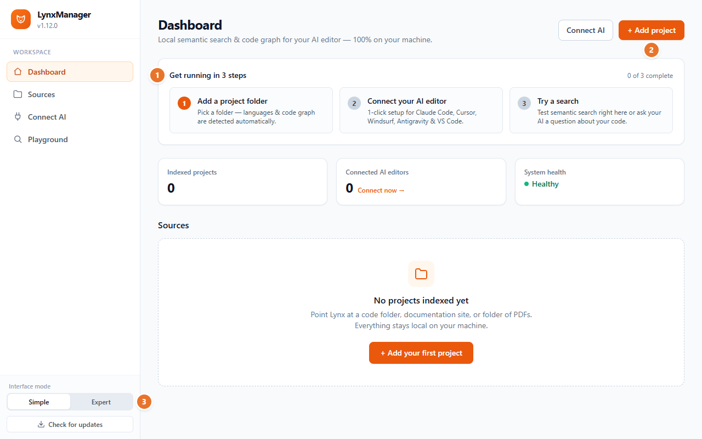

1. the three steps, ticked off as you go
2. add a project folder
3. Simple or Expert mode

### Add a project

Pick the folder of your repository with Browse, or paste its path, then Detect: Lynx scans the folder and fills in the file types it found. The graph and the file watcher are on by default. Add starts the first index build right away.

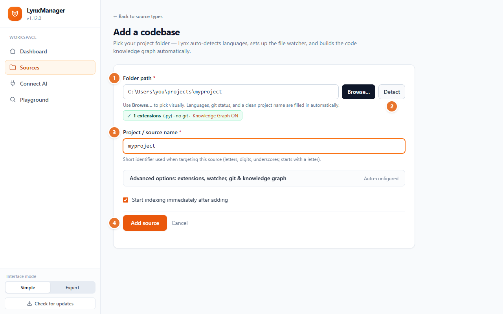

1. the project folder
2. Detect fills in the file types
3. the name your AI editor sees
4. add it and build the index

### The project is ready

Once the index is built the project shows as Ready. The cards at the top count indexed projects and connected editors, and show the result of the health check.

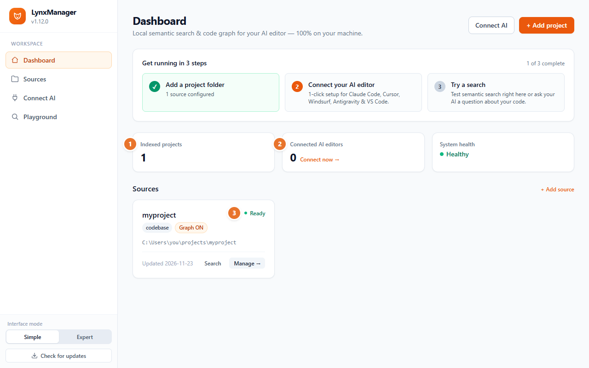

1. how many projects are indexed
2. editors that already use Lynx
3. the project, indexed and searchable

### Try a search

The Playground runs the same search your AI editor gets over MCP. Ask in plain words, or paste a symbol name: each result is a whole function or class, with its file, lines and score.

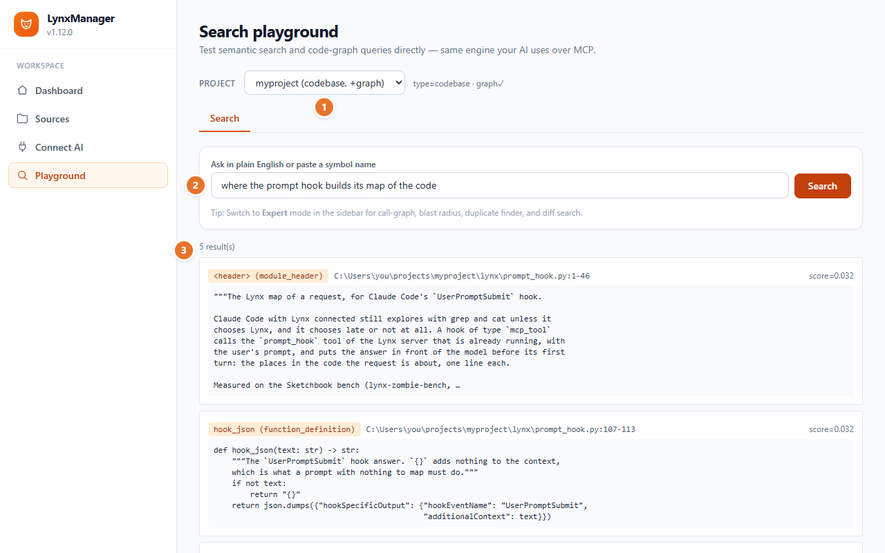

1. the project to search
2. a question in plain words, or a name
3. results with file, lines and code

### Connect your AI editor

Connect AI writes the Lynx entry into your editor's MCP config with one click, keeps a backup, and leaves your other servers alone. Editors that are not installed are listed at the bottom; any MCP client can use the snippet in the last card.

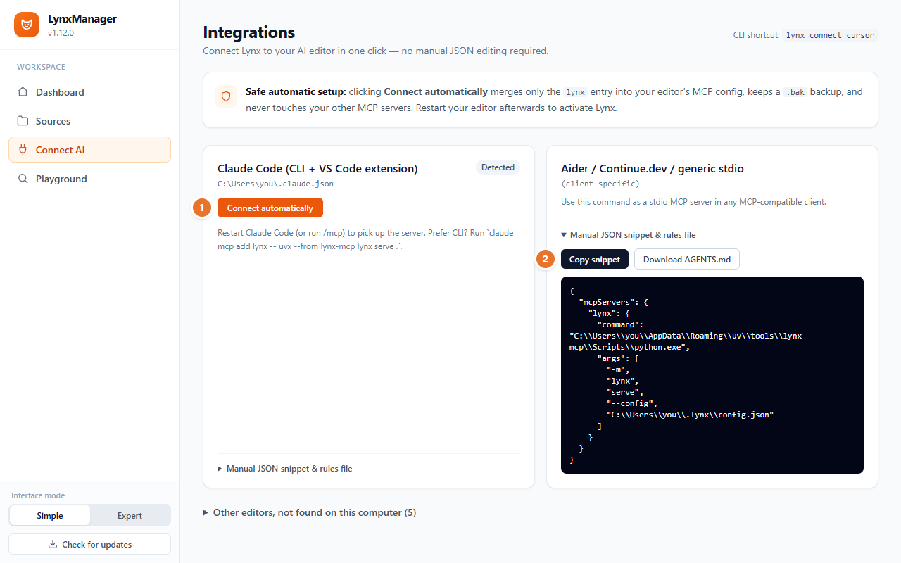

1. one click per editor
2. the same entry, for any other MCP client

## Expert mode

### Expert mode

Expert mode adds the details: chunks and graph size per project, which process keeps each index current, and the Config, Doctor and OpenAPI pages.

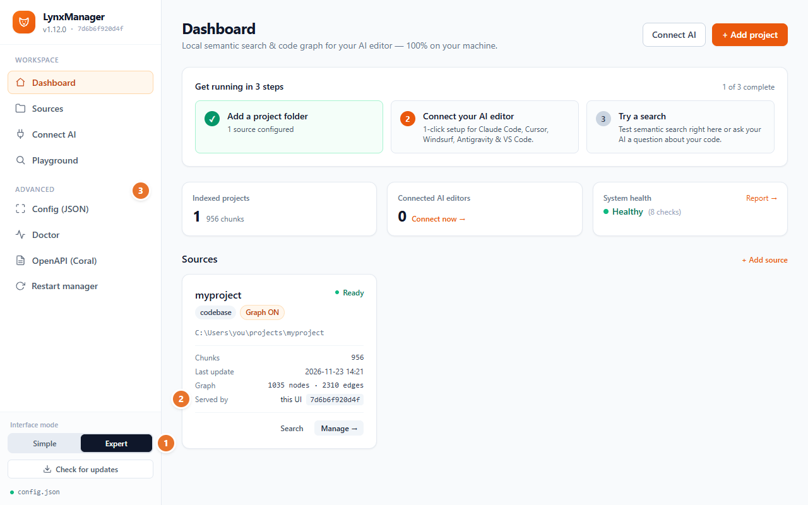

1. the switch
2. who keeps this index current
3. Config, Doctor, OpenAPI

### A project's page

Every project has a page with its index and graph status, a rebuild button and the way to remove it, with or without its index.

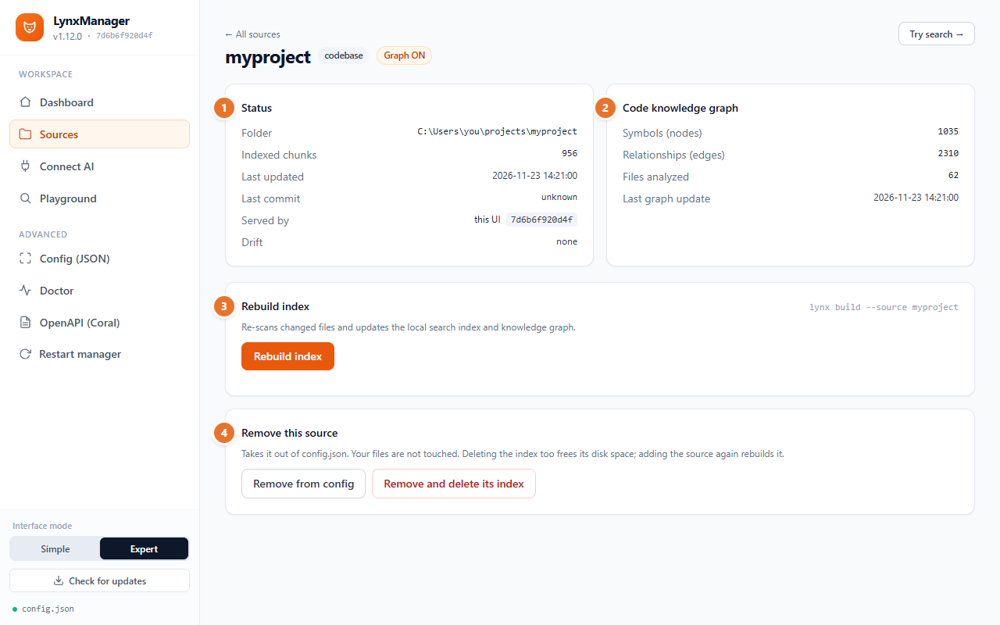

1. index status
2. the code graph
3. rebuild
4. remove it

### Code-aware tools

The Code-aware tab runs the tools that read the code graph: here `describe_symbol`, a function's code, callers and callees in one answer. The output is the text your AI editor receives.

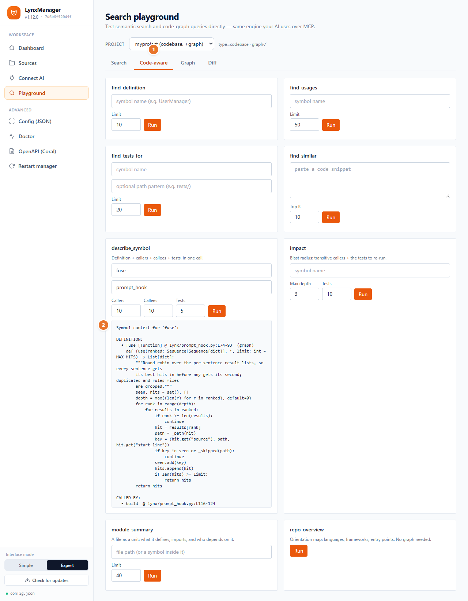

1. Code-aware tools
2. the answer the AI gets

### The code graph

The Graph tab asks the graph directly: callers, callees, subclasses, imports, paths between two symbols. Here, who calls `fuse`.

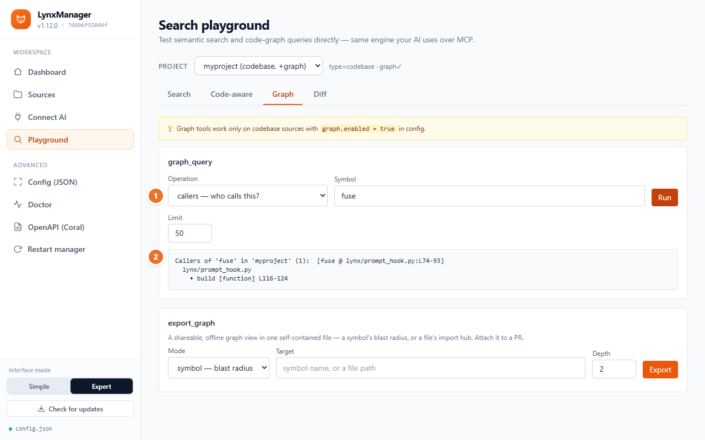

1. the question
2. resolved edges, with file and line

### Doctor

Doctor runs the same checks as `lynx manager doctor`: the config, the embedding model, each index and the editors connected.

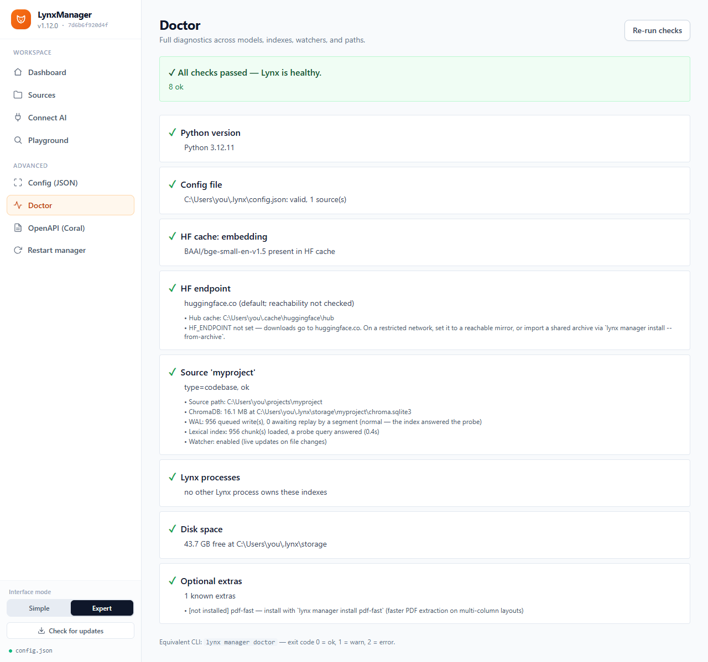

### Config

The raw `config.json`, with the validation the command line uses and a backup of the previous version on every save.

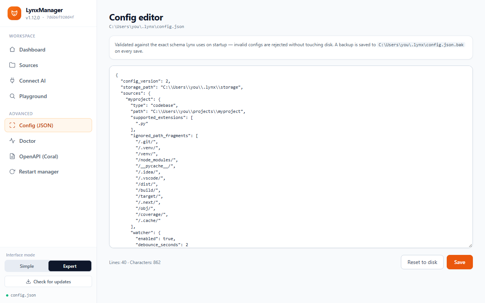
